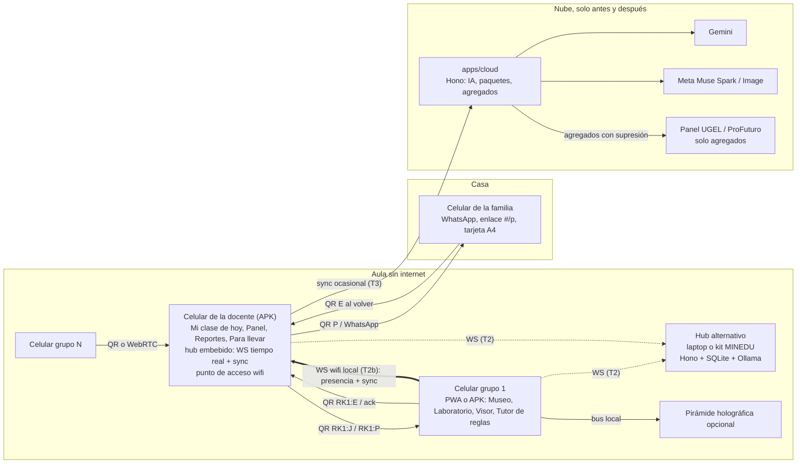
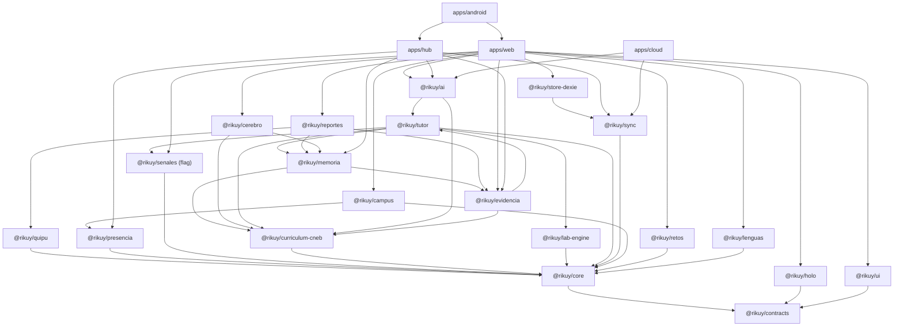
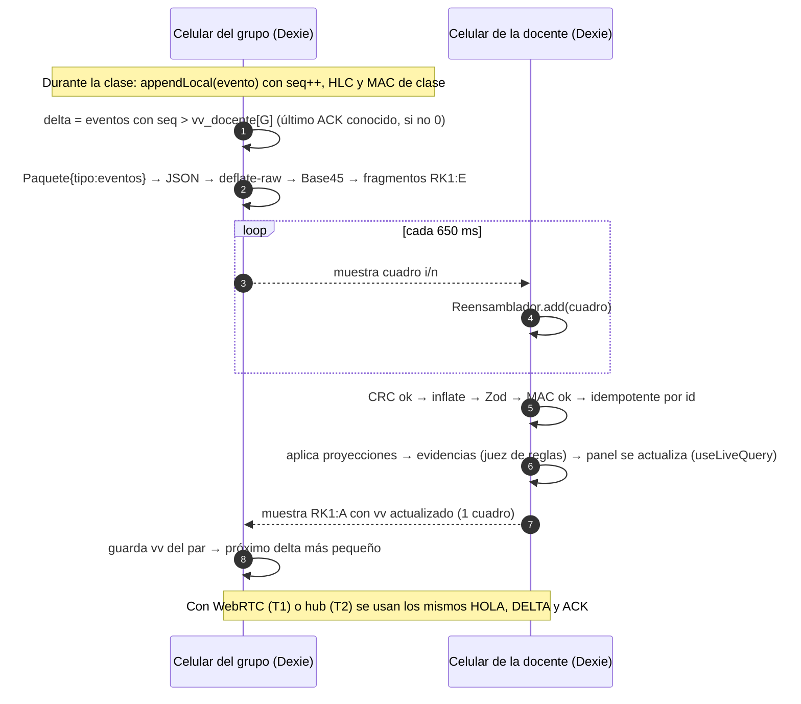
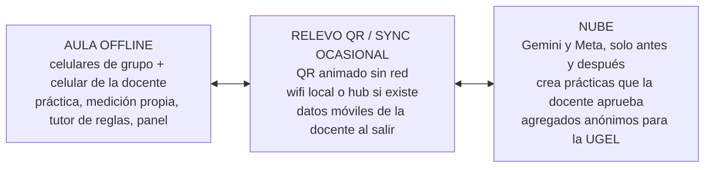

# Rikuy: arquitectura técnica del ecosistema

> Documento del arquitecto técnico, 5 nov 2026. Rama `feat/ecosistema`.
> Se alinea con [VISION.md](VISION.md) (promesa, principios y recorrido estrella) y con ECOSISTEMA.md e INFORMATION_ARCHITECTURE.md, que escribe el arquitecto de producto. Si este documento y los de producto discrepan en *qué* se construye, mandan los de producto. En *cómo* se construye, manda este.
> Convenciones: **(verificar)** marca una afirmación técnica que no se comprobó en un dispositivo o en una cuenta real. **Decisión** marca una elección cerrada. **Puerta** marca un criterio de aceptación verificable.

---

## 0. Resumen

| Tema | Decisión |
|---|---|
| Web | `apps/web` pasa de TypeScript sin framework con 4 HTML a **Vite + React 19 + TypeScript + Tailwind CSS v4 + shadcn/ui**, una SPA con **enrutamiento por hash**, PWA con **Workbox** (`vite-plugin-pwa`, estrategia `injectManifest`) e **IndexedDB con Dexie** |
| Núcleo | Los paquetes de dominio siguen sin framework (TypeScript puro, sin DOM salvo donde se declara). React solo vive en `apps/web` y `packages/ui` |
| Contratos | Un paquete nuevo, `@rikuy/contracts`, con esquemas **Zod**. Es la fuente única de tipos, de validación en tiempo de ejecución y de JSON Schema para las llamadas a herramientas de la IA |
| Museo Rikuy (metáfora central, mundo 2D tipo Gather) | **Salas = áreas curriculares del CNEB; exhibiciones = experimentos del Laboratorio.** Se construye con un **motor propio sobre Canvas 2D**, mapas **Tiled JSON**, superposiciones en DOM y lógica pura en `@rikuy/campus`. Se descartan Phaser 3 y PixiJS (justificación en 1.3) |
| Presencia multijugador local | **Protocolo de tiempo real** (`@rikuy/presencia`) sobre **WebSocket en el hub** (el celular de la docente con contenedor nativo, una laptop o el kit). Gestiona presencia, posiciones, entrada y salida de salas y órdenes de la docente, con interés por sala. Los mismos mensajes pueden viajar por un canal WebRTC (sección 3.9) |
| Visor de exhibiciones | El renderizador Three.js (`@rikuy/holo`) pasa a ser el **visor de cada exhibición** (pantalla normal o pirámide). Tiene **control por gestos de mano en el dispositivo** con MediaPipe Tasks empaquetado para uso sin red: no se guarda ni se envía ningún fotograma, y la docente tiene un interruptor |
| Memoria de aprendizaje | **Memoria por estudiante, local primero**, vinculada a competencias del CNEB (`@rikuy/memoria`). La recuperación es estructurada y por palabras clave (MiniSearch); los *embeddings* son opcionales y solo en el hub. Alimenta al tutor y a los reportes. Se borra con **borrado criptográfico** |
| Reportes | **Motor de reportes por competencia** (`@rikuy/reportes`) para docente, director y UGEL. Genera en el dispositivo; PDF por impresión y CSV en local; el envío al director o la UGEL se hace cuando hay red, siempre con agregados y supresión de celdas pequeñas |
| Lenguas | i18n con **castellano y quechua primero**, abierto a cualquier lengua por registro de catálogos. **El audio en quechua sale de grabaciones de hablantes nativos** (pipeline de recursos); **la síntesis de voz solo se usa en castellano** |
| Quipu de logros | Economía **cooperativa** en un **libro contable *append-only***: nudos por logros de grupo y de clase que desbloquean la decoración del Museo. **Sin compras, sin ranking individual, sin pérdidas** |
| Rikuy Guardián (decisión del usuario, 5 nov 2026; antes "Señales de aprendizaje") | Módulo `@rikuy/senales` (nombre de código) **detrás de una *feature flag*, apagado por defecto**. Nivel 1 (por defecto): **sin cámara ni micrófono**; eventos de aprendizaje no biométricos y un *check-in* voluntario que declara el propio alumno. Ofrece ayuda al grupo y entrega a la docente responsable **sugerencias de acercamiento** (máximo 3 por semana y tutor; la decisión es humana) y agregados del curso con 5 o más respuestas. Nivel 2 (cámara y voz): código aislado, apagado y bloqueado en la UE. **Riesgo legal y de pitch alto** (sección 4.9) |
| Mi Cerebro Rikuy | Mapa de conocimiento **alimentado por la memoria real y por las competencias del CNEB**: cada nodo encendido enlaza a la evidencia que lo sustenta. Nada es ilustrativo (sección 3.12) |
| Exhibiciones multiformato | Cada exhibición declara recursos tipados: **video, audio, diagrama, holograma y quiz**, con lengua, revisión, licencia, *hash* y política de precache (sección 3.13) |
| Datos | Registro de eventos *append-only* por dispositivo, con **reloj lógico híbrido (HLC)** y **vectores de versión**. Las entidades son proyecciones del registro. Hay registros LWW por campo solo para lo que edita la docente. No se usa una librería CRDT |
| Transporte | Escalera de cuatro peldaños con el mismo protocolo: **T0 relevo QR** (siempre) → **T1 WebRTC en la red local con señalización por QR** (experimental) → **T2 hub local** (laptop, kit MINEDU o, más adelante, el celular de la docente con un contenedor nativo) → **T3 nube ocasional** |
| IA | Puertos por capacidad con adaptadores: **Gemini** (generar, validar, multimodal), **Meta Muse Spark** (segundo revisor), **Muse Image** (pictogramas), **Ollama/WebLLM** (local, opcional), **agente de reglas** (piso sin red, siempre). Toda salida pasa por Zod y por validadores de dominio. Ningún LLM está en el camino crítico del aula |
| Servidores | `apps/server` pasa a ser `apps/hub` (Node, local). Aparece `apps/cloud` (pasarela para las llaves de la IA, registro de paquetes, agregados para la UGEL). Ambos usan **Hono** para compartir rutas |
| Trabajo | 10 frentes paralelos más un sprint 0 de contratos. Cada frente es dueño de directorios, trabaja en su propio `git worktree` y solo comparte los contratos (sección 5) |

---

## 1. Pila objetivo y justificación

### 1.1 Punto de partida (verificado en el código)

| Pieza | Estado actual | Archivo |
|---|---|---|
| Web | Vite 8 + TypeScript sin framework, 4 entradas HTML (`index`, `display`, `control`, `panel`), Three.js 0.187 | `apps/web/vite.config.ts`, `apps/web/src/pages/*.ts` |
| PWA | `sw.js` hecho a mano: precachea 4 URL y guarda el resto mientras se usa. La primera carga de cada recurso necesita red | `apps/web/public/sw.js` |
| Datos en cliente | Cola de eventos en `localStorage` (máximo 1.000) y envío por `fetch` cada 5 s | `apps/web/src/analytics/tracker.ts` |
| Bus | WebSocket al servidor + `BroadcastChannel` | `apps/web/src/net/bus.ts` |
| Servidor | Express 5 + `ws`, relevo por salas, JSONL por sala, agente LLM (Anthropic o compatible con OpenAI) con respaldo de reglas | `apps/server/src/*` |
| Núcleo | `@rikuy/core` sin dependencias: currículo, física, herramientas, analítica por regex, agente de reglas, protocolo. Pruebas con `node:test` (6 casos) | `packages/core/src/*` |
| Dependencias de red ocultas | MediaPipe descarga WASM y modelo desde jsDelivr y Google Storage | `apps/web/src/input/gestures.ts:23-24` |
| Deudas conocidas | Regex sin límite de palabra (`mas` dentro de `masa`); `conclusion_correcta` nunca se escribe; `pendulo.ts` remite a un `input/motion.ts` que no existe | `packages/core/src/analytics.ts`, `apps/web/src/scenes/pendulo.ts:4` |

### 1.2 Web: Vite + React + TypeScript + Tailwind + shadcn/ui

**Decisión.** Migrar `apps/web` a React. Es la opción recomendada en el encargo y se confirma por estas razones:

1. **El equipo de diseño trabaja con shadcn/ui.** Con shadcn el diseño y el código usan las mismas piezas (Radix + Tailwind, copiadas en el repo, sin dependencia de una librería cerrada). La alternativa de seguir sin framework obliga a reescribir a mano diálogos, hojas, pestañas y formularios accesibles, que son la mitad de la interfaz de la docente.
2. **La interfaz crece de 4 pantallas a unas 30** (Mi clase de hoy, Creador, Panel, Familia, Museo, Laboratorio, Visor, Retos, Mi Cerebro, Reportes, Quipu, Ajustes). Sin componentes ni estado reactivo ese crecimiento se vuelve frágil.
3. **Dexie trae `useLiveQuery`**: la interfaz se actualiza sola cuando el registro de eventos cambia (por QR, WebRTC o hub), sin cableado manual.
4. **Vite ya está.** La migración no cambia el empaquetador ni la configuración HTTPS (`@vitejs/plugin-basic-ssl`).

| Capa | Elección | Por qué | Alternativa descartada |
|---|---|---|---|
| UI | React 19 + shadcn/ui (Radix) + Tailwind CSS v4 | Diseño y código comparten piezas; accesibilidad de Radix | Svelte o Preact: menos fricción de peso, pero el equipo de diseño ya entrega en shadcn |
| Enrutamiento | React Router en modo SPA con **`createHashRouter`** | Funciona igual en GitHub Pages, en el hub local y en el kit MINEDU sin reescrituras de servidor. Las URL viejas (`display.html?sala=…`) redirigen a `#/holo?…` | Rutas con historial: exigen *fallback* en cada servidor |
| Estado de UI | Zustand (estado efímero: modo, panel abierto, conexión) | Pequeño y sin proveedor | Redux: demasiado para el caso |
| Datos | **Dexie 4** sobre IndexedDB + `dexie-react-hooks` | Consultas reactivas, índices compuestos, migraciones por versión, funciona en Chrome Android antiguo | `idb` (lo usa Yaku): más bajo nivel, sin consultas reactivas |
| Validación | **Zod 4** en `@rikuy/contracts`, con `z.toJSONSchema()` para las herramientas de la IA | Un esquema sirve para tipos, validación y JSON Schema | Ajv + tipos a mano: dos fuentes de verdad |
| PWA | **`vite-plugin-pwa` con `injectManifest`** (Workbox) | Precache generado del *build* (corrige M1 del plan), SW propio para rutas especiales (`/api` a red, paquetes por *hash*) | `sw.js` a mano: es lo que hoy no precachea |
| i18n | i18next + react-i18next con formato ICU (`i18next-icu`), catálogos por lengua con metadatos de revisión (sección 4.8). **Castellano y quechua primero**; cualquier lengua nueva se agrega registrando un catálogo, sin tocar código | Cadenas de respaldo `quy → es`, pluralización, carga perezosa | Lingui: compila mejor, pero el flujo de revisión por hablantes es más simple con JSON |
| Íconos y pictogramas | lucide-react (UI) + SVG propios (pictogramas) | Peso bajo, sin red | — |
| Pruebas | Vitest (unidad y componentes con Testing Library), Playwright (e2e, modo avión) | Sección 5.6 | `node:test`: se migra |

**Presupuesto de rendimiento (Puerta).** Perfil de referencia: Android Go de 2 GB, Chrome actualizado, CPU con aceleración ×4 en Lighthouse.

| Recurso | Límite |
|---|---|
| JS inicial de la *shell* (Mi clase de hoy) | ≤ 200 KB gzip |
| Fragmento Laboratorio (sin holograma) | ≤ 120 KB gzip |
| Fragmento Museo Rikuy (motor + primer mapa) | ≤ 150 KB gzip, sin contar *sprites* |
| Fragmento holograma (Three.js + escenas) | ≤ 250 KB gzip, solo bajo demanda |
| Precache total en la primera instalación | ≤ 8 MB (incluye *sprites* del Museo y audio de la práctica estrella) |
| Interacción tras abrir en frío sin red | < 3 s hasta "Mi clase de hoy" utilizable |
| Museo Rikuy | ≥ 30 fps sostenidos con CPU ×4 |

### 1.3 Motor del Museo Rikuy: Canvas 2D propio, no Phaser ni PixiJS

**Contexto verificado.** AulaQuipu no usa motor: dibuja el piso una sola vez en un `<canvas>` y pone avatares y muebles como elementos DOM encima. Tiene un único bucle `requestAnimationFrame`, una grilla de colisión booleana, búsqueda de caminos BFS y proximidad por `distToRect` (`apps/web-app/lib/campus/map.ts`, `components/campus/world.tsx`). Su multijugador es LiveKit en la nube y sus *sprites* son de Habbo (27 MB, con derechos de Sulake): **no se reutilizan ni el arte ni el transporte**.

**Necesidad de Rikuy: el Museo Rikuy.** Es un museo 2D interactivo y navegable:

- **Cada sala es un área curricular del CNEB** (Ciencia y Tecnología primero; luego Matemática, Comunicación, Personal Social…). Una sala tiene subsalas por competencia.
- **Cada exhibición es un experimento del Laboratorio** (una `Practica` aprobada). Al acercarse, la exhibición se abre en el visor (1.4) y en el flujo de la práctica.
- Rikuy, una piedra de río con un ojo grande sobre un cordel anudado de ámbar (ese cordel es también el péndulo), es el guía. *Nota de renombrado: antes era una vizcacha.* También hay puertas a Retos y a la Biblioteca de Familia.
- En el aula, cada dispositivo tiene uno o más avatares (los integrantes del grupo). Con el hub local (3.9) se ve a los demás grupos en tiempo real dentro de la misma sala, hasta ≈ 40 avatares.
- No hay física, combates ni cientos de entidades.

El mapa del Museo se **genera a partir del contenido**: una plantilla Tiled por tipo de sala más el catálogo de prácticas aprobadas, que se colocan en los pedestales libres. Así, una práctica nueva aparece como exhibición sin editar el mapa.

| Criterio (gama baja Android) | Phaser 3 | PixiJS v8 | Canvas 2D propio |
|---|---|---|---|
| Peso del motor (gzip, aprox.) | ≈ 300-350 KB | ≈ 100-150 KB (+ *tilemap*) | ≈ 10-20 KB |
| Dependencia de WebGL | Sí (tiene respaldo Canvas, pero pierde rendimiento) | Sí (WebGPU/WebGL; respaldo Canvas limitado) | No: Canvas 2D funciona en cualquier GPU incluida en listas negras |
| Pérdida de contexto WebGL en equipos con poca RAM | Riesgo real | Riesgo real | No aplica |
| Mapas Tiled | Nativo | Con complemento | Cargador propio de ≈ 150 líneas (capas de *tiles* + capa de objetos) |
| Accesibilidad (lector de pantalla, teclado) | Todo dentro del lienzo | Todo dentro del lienzo | Lo interactivo es DOM/React encima del lienzo: botones reales con foco y etiqueta |
| Pruebas en Node | Difícil | Difícil | La lógica (mapa, colisión, BFS, zonas) es pura y se prueba con Vitest |
| Tiempo para el equipo | Curva de motor y su ciclo de escenas | Hay que construir cámara y entrada | AulaQuipu demostró el patrón en ≈ 800 líneas |

**Decisión: Canvas 2D propio**, con este diseño:

- El piso y la decoración estática se pre-renderizan en **trozos de 16×16 *tiles*** sobre `OffscreenCanvas` (o un `canvas` oculto) y se dibujan con `drawImage`. Por cuadro solo se redibujan los avatares, Rikuy y los indicadores.
- La resolución interna se fija a `devicePixelRatio ≤ 1,5` y el bucle se limita a 30 fps. El bucle se pausa con `visibilitychange`.
- **Mapas en Tiled JSON** (el equipo de diseño los edita con Tiled, que es libre). La capa de objetos define `puerta`, `zona`, `npc` e `interactivo`, con propiedades `destino` (ruta de la app), `practicaId` y `retoId`.
- **Hay un modo lista accesible**: toda sala y exhibición del Museo también se alcanza desde "Mi clase de hoy". El Museo es una puerta motivadora, no un requisito.
- **Puerto de render** (`RenderizadorMundo`). Si más adelante hace falta un efecto que el Canvas no aguante, se escribe un adaptador PixiJS sin tocar el dominio.

Se descarta Phaser por peso, dependencia de WebGL y porque su ciclo de escenas compite con React por el control de la pantalla. Se descarta PixiJS porque obliga a construir cámara, entrada y *tilemap*, igual que el motor propio, pero con 10 veces más peso y riesgo de WebGL.

### 1.4 Visor de exhibiciones (el holograma como módulo) y gestos

`HoloRenderer`, `ViewController`, `SceneManager` y `Morph` (Three.js) ya funcionan y no dependen del DOM de las páginas: reciben un `canvas` y opciones. Pasan a `@rikuy/holo` sin reescritura y se convierten en el **visor de exhibiciones** del Museo.

- Se expone como `<VisorExhibicion practica escena modo />` en `apps/web/src/features/visor`, cargado con `React.lazy`.
- Tiene tres modos: **pantalla** (por defecto, dentro del Museo), **pirámide** y **cajita** (el holograma de siempre, opcional).
- Mantiene `public/models/<id>.glb` como reemplazo opcional de las escenas procedurales.

**Gestos de mano en el dispositivo** (`apps/web/src/platform/gestos/`):

- **Modelo:** MediaPipe Tasks Vision (`HandLandmarker` o `GestureRecognizer`). El `.wasm` y el `.task` se **empaquetan en el repo** (`apps/web/public/mediapipe/`, versión fijada y con *hash*). Ya no se cargan desde jsDelivr ni Google Storage, como hace hoy `gestures.ts:23-24`.
- **Descarga:** forman un grupo de precache aparte (≈ 8-10 MB, **verificar**). Se descarga cuando la docente habilita "gestos" para la clase, desde la nube o desde el hub local.
- **Sin fotogramas guardados:** el video vive solo en un `<video>` en memoria; el procesamiento corre en un *worker* y solo salen 21 puntos por mano, convertidos en gestos (girar, acercar, señalar, pausar). Ningún fotograma ni punto se escribe en Dexie, se envía por la red o se dibuja en un `canvas` exportable. Hay un indicador visible de cámara activa.
- **Interruptor de la docente:** evento firmado `gestos.interruptor` (por clase o por grupo). Al recibirlo, la cámara se detiene en el acto y el visor vuelve al control táctil.
- **Lista blanca de modelos:** `public/mediapipe/` admite `hand_landmarker.task` y `gesture_recognizer.task`. `face_landmarker.task` solo se admite en `public/mediapipe/senales/`, dentro del grupo de precache de Señales, y solo se empaqueta cuando se compila con `VITE_FLAG_SENALES=1` (4.9). CI falla ante cualquier otro modelo.

### 1.5 Servidores: Hono para el hub y la nube

- `apps/hub` (Node ≥ 22): servidor local en la laptop, en el kit MINEDU o, en una fase posterior, embebido en el celular de la docente. Sirve la PWA, el relevo WebSocket, el endpoint de sincronización y un *proxy* opcional a Ollama.
- `apps/cloud`: pasarela *serverless* (Vercel o Cloud Run). Guarda las llaves de Gemini y Meta. Expone generación y revisión de prácticas, pictogramas, foto a tabla, registro de paquetes publicados y entrada de agregados anónimos para la UGEL.
- **Hono** corre en Node (`@hono/node-server`) y en funciones *edge/serverless*. Las rutas de sincronización (`/sync/*`) son el mismo código en el hub y en la nube. Express 5 se retira porque solo aporta en Node.
- Persistencia del hub: SQLite (`node:sqlite`, incluido en Node; **verificar** su estabilidad en la versión LTS que se fije, con `better-sqlite3` como alternativa). Persistencia de la nube: Postgres administrado, solo para paquetes publicados y agregados; nunca texto de alumnos.

---

## 2. Monorepo: paquetes, responsabilidades y reglas de dependencia

### 2.1 Disposición objetivo

```
rikuy-lab/
├─ packages/
│  ├─ contracts/        @rikuy/contracts       Esquemas Zod, tipos, versiones, fixtures. Sin lógica. Dep: zod
│  ├─ core/             @rikuy/core            Núcleo puro: ids (ULID), HLC, normalización de texto, Result, puertos genéricos (Reloj, Aleatorio)
│  ├─ curriculum-cneb/  @rikuy/curriculum-cneb Subconjunto CNEB (CyT primaria y secundaria), verificador de cita literal, grafo de conceptos
│  ├─ lab-engine/       @rikuy/lab-engine      Máquina de estados de la práctica, modelos físicos, estadística de mediciones, puerto de sensores
│  ├─ tutor/            @rikuy/tutor           Escalera de pistas, agente de reglas, juez de razonamiento, honestidad, interruptor, validación de comandos
│  ├─ ai/               @rikuy/ai              Puertos de IA + adaptadores (gemini, meta, openai-compat/ollama, webllm, reglas), enrutador y presupuesto
│  ├─ sync/             @rikuy/sync            Registro de eventos, proyecciones, vectores de versión, códec QR, transportes (qr, webrtc, ws, http)
│  ├─ store-dexie/      @rikuy/store-dexie     Adaptador de los repositorios sobre Dexie (navegador)
│  ├─ evidencia/        @rikuy/evidencia       Agregación para el panel: cita literal por indicador, "no evaluable", resumen en 3 partes, mapeo a competencias
│  ├─ memoria/          @rikuy/memoria         Memoria de aprendizaje por estudiante: proyección, índice (MiniSearch), recuperación por competencia, borrado criptográfico
│  ├─ reportes/         @rikuy/reportes        Modelos de reporte por competencia (docente, director, UGEL), supresión, render HTML imprimible y CSV
│  ├─ quipu/            @rikuy/quipu           Libro contable cooperativo de nudos: reglas de emisión, saldo por proyección, desbloqueos del Museo
│  ├─ presencia/        @rikuy/presencia       Protocolo de tiempo real del Museo: presencia, posiciones, salas, órdenes de la docente (cliente y servidor puros)
│  ├─ senales/          @rikuy/senales         Señales de aprendizaje (feature flag): blendshapes/prosodia → estados gruesos → política de apoyo; agregados por grupo
│  ├─ cerebro/          @rikuy/cerebro         Modelo del mapa "Mi Cerebro Rikuy": nodos CNEB + conceptos, estado desde la memoria, layout determinista
│  ├─ campus/           @rikuy/campus          Dominio del Museo (mapa Tiled, salas = áreas CNEB, exhibiciones, colisión, BFS, director) + renderizador Canvas (/canvas)
│  ├─ retos/            @rikuy/retos           Definición y motor de retos contextuales (sin puntajes de persona)
│  ├─ lenguas/          @rikuy/lenguas         Registro de lenguas, catálogos con estado de revisión, manifiesto de audio, TTS solo castellano
│  ├─ holo/             @rikuy/holo            Visor de exhibiciones: renderizador Three.js + escenas (lo actual)
│  └─ ui/               @rikuy/ui              shadcn/ui + tokens + componentes presentacionales (átomos, moléculas, organismos)
├─ apps/
│  ├─ web/              @rikuy/web             PWA React: composición, rutas, adaptadores de plataforma (cámara, gestos, voz, sensores, compartir)
│  ├─ hub/              @rikuy/hub             Servidor local Hono + SQLite + WS (sync + presencia) + proxy Ollama (sucesor de apps/server)
│  ├─ android/          @rikuy/android         Contenedor Capacitor de apps/web; en el celular de la docente embebe el hub (servidor HTTP/WS)
│  └─ cloud/            @rikuy/cloud           Pasarela Hono: IA con llaves, registro de paquetes, recepción de reportes agregados
├─ tools/
│  └─ audio/            Pipeline de grabaciones: guion → normalización → Opus → hash → manifiesto
├─ content/
│  ├─ practicas/        Paquetes de práctica aprobados (*.json validados por contracts) = exhibiciones
│  ├─ museo/            Plantillas Tiled de salas y sprites propios
│  └─ audio/            Grabaciones de hablantes nativos (quechua) revisadas
├─ e2e/                 Playwright: arnés común + specs por frente (e2e/<frente>/)
└─ docs/ecosistema/
```

### 2.2 Responsabilidades y puertos (arquitectura hexagonal)

Cada paquete de dominio declara sus **puertos** (interfaces) en `src/puertos.ts`. Los adaptadores que tocan el mundo exterior (IndexedDB, cámara, red, LLM) viven en un paquete adaptador o en `apps/*`.

| Paquete | Dominio que contiene | Puertos que declara | Adaptadores (dónde) |
|---|---|---|---|
| `core` | ULID, HLC, `normalizar()` con límites de palabra, `Result<T,E>` | `Reloj`, `Aleatorio` | `apps/web`, `apps/hub` |
| `curriculum-cneb` | Competencias, capacidades y desempeños (texto oficial), `ubicarCita(cita)` exacta, grafo de conceptos | — (datos) | — |
| `lab-engine` | Flujo `predecir → medir → comparar → concluir`, modelos (`periodoPendulo`, `actividadLactasa`, `frecuenciaRespiratoria`), media, desviación, error relativo frente al modelo | `Sensor` (aceleración, cronómetro), `Repositorio<Medicion>` | `apps/web/src/platform/sensores.ts` (DeviceMotion), Dexie |
| `tutor` | Intenciones del alumno, escalera de pistas, política de honestidad, interruptor, juez (nivel + cita + "no evaluable"), `validarComandos()` | `ModeloTutor`, `ModeloJuez` | `@rikuy/ai` |
| `ai` | Enrutador por capacidad, presupuesto, reintentos, privacidad | `GeneradorPractica`, `RevisorPractica`, `Pictogramas`, `VisionTabla`, `BorradorTraduccion`, `ModeloTutor`, `ModeloJuez` | `ai/src/adaptadores/{gemini,meta,openai-compat,webllm,reglas}.ts` |
| `sync` | Registro, proyecciones, vector de versión, fusión, códec QR, firma | `Transporte`, `RepositorioEventos`, `Cripto` | `store-dexie`, `apps/hub` (SQLite), `apps/web` (cámara y QR) |
| `evidencia` | Indicadores por grupo, citas literales, "no evaluable", resumen en 3 partes (plantillas), mapeo a desempeños | — (funciones puras sobre eventos) | — |
| `campus` | Mapa del Museo generado desde plantillas y catálogo, salas por área CNEB, exhibiciones, colisión, BFS, director | `RenderizadorMundo`, `EntradaMundo`, `Presencia` | `campus/src/canvas/*`, `apps/web` (presencia vía `@rikuy/presencia`) |
| `presencia` | Mensajes de tiempo real, interés por sala, interpolación, límites de frecuencia, autoridad de la docente | `CanalTiempoReal` (WS o WebRTC) | `apps/web` (cliente WS), `apps/hub` y `apps/android` (servidor) |
| `memoria` | `MemoriaEntrada` derivada de eventos, índice por palabras clave, recuperación por competencia y concepto, olvido | `IndiceVectorial` (opcional), `Cripto` | MiniSearch (incluido), `apps/hub` (*embeddings* por Ollama) |
| `reportes` | `ReporteCompetencia` por estudiante, grupo, clase, colegio y UGEL; supresión k ≥ 5 | `Exportador` | `apps/web` (impresión a PDF, Blob CSV), `apps/cloud` (recepción) |
| `quipu` | Reglas de emisión, asientos, saldo, desbloqueos | — (puro sobre eventos) | — |
| `senales` | Mapeo de *blendshapes* y prosodia a estados gruesos con histéresis, política de apoyo, agregación por grupo, compuertas (flag, consentimiento, interruptor) | `FuenteRostro`, `FuenteProsodia` | `apps/web/src/platform/senales/` (MediaPipe Face Landmarker en un *worker*, Web Audio) |
| `cerebro` | Grafo de conocimiento (desempeños CNEB + conceptos), estado de cada nodo desde `MemoriaEntrada`, layout precalculado | `ConsultaMemoria` | — |
| `retos` | Retos contextuales (feria, chacra, llamas), validación de respuesta, progreso por grupo | `Repositorio<Progreso>` | Dexie |
| `lenguas` | Catálogos, estado de revisión, variedad, regla "no se muestra lo no revisado a alumnos" | `ReproductorAudio` | `apps/web` |
| `holo` | Renderizador, escenas, vista | Recibe `EstadoLab` por suscripción | — |
| `ui` | Componentes presentacionales | — | — |

**Patrón contenedor-presentacional.** `packages/ui` solo tiene componentes que reciben *props*. Los contenedores (que leen Dexie, llaman al tutor y emiten eventos) viven en `apps/web/src/features/<modulo>/`.

### 2.3 Reglas de dependencia (se hacen cumplir en CI)

```
contracts  ←  core  ←  {curriculum-cneb, lab-engine, tutor, sync, evidencia, campus, retos, lenguas}
                         tutor → curriculum-cneb, lab-engine (solo tipos y modelos)
                         evidencia → curriculum-cneb, tutor (solo el juez)
                         memoria → curriculum-cneb, evidencia;  tutor → memoria (solo el puerto de consulta)
                         reportes → evidencia, memoria, curriculum-cneb, quipu
                         quipu → core;  presencia → core;  campus → curriculum-cneb (salas)
                         senales → core;  tutor → senales (solo el tipo EstadoApoyo; nunca al revés)
                         cerebro → memoria, curriculum-cneb
                         memoria, evidencia, reportes, cerebro, quipu ✗→ senales   (regla dura: las señales no llegan a ningún registro ni reporte individual)
                         ai → tutor (puertos), curriculum-cneb (verificador)
store-dexie → sync, contracts
holo → contracts (solo tipos)          ui → (nada de dominio; solo tipos de contracts)
apps/web → todo lo anterior            apps/hub → contracts, core, sync, presencia, tutor, evidencia, memoria, ai (adaptadores locales)
apps/android → apps/web (build) + el núcleo de apps/hub empaquetado     apps/cloud → contracts, core, ai, curriculum-cneb, reportes (validación), sync (solo /sync)
```

1. **Ningún paquete de `packages/*` importa de `apps/*`.**
2. **Los paquetes de dominio no importan React, Dexie, Three.js ni `fetch`.** Las excepciones declaradas son `holo` (Three.js), `ui` (React), `store-dexie` (Dexie), `campus/canvas` (DOM Canvas) y `ai/adaptadores` (`fetch`).
3. **Las llaves de API solo existen en `apps/cloud`.** El navegador nunca importa `ai/adaptadores/gemini` ni `meta`. Esto se hace cumplir con `exports` condicionales y una regla de dependency-cruiser.
4. **`contracts` solo cambia por PR al dueño del sprint 0.** Durante un sprint los cambios son aditivos (campos opcionales, nuevos tipos de evento). Un cambio que rompe sube `SCHEMA_VERSION` y trae su migración.
5. **Sin ciclos.** Se verifica con `dependency-cruiser` en `npm run lint:deps`.

---

## 3. Modelo de datos offline-first y sincronización

### 3.1 Principios

- **La verdad es un registro de eventos *append-only* por dispositivo.** Cada dispositivo escribe solo sus eventos con `seq` creciente. Las entidades (Clase, Grupo, Medición…) son **proyecciones** deterministas del registro.
- **Casi todo es inmutable por naturaleza**: una medición, una respuesta y una evidencia no se editan. Una corrección es un evento nuevo (`medicion.anulada`). Así la fusión no tiene conflictos.
- **Lo mutable es poco y tiene dueño**: la configuración de la clase, el borrador de práctica y el interruptor del tutor solo los escribe la docente. Se resuelven con **LWW por campo** ordenado por HLC, y solo se aceptan eventos firmados por el dispositivo docente de esa clase.
- **No hay librería CRDT** (Yjs, Automerge). El volumen es pequeño, el ancho de banda del QR es escaso (cada byte cuenta) y las proyecciones deterministas se prueban mejor con pruebas de propiedades. Si un día hace falta edición colaborativa de texto (dos docentes sobre la misma práctica), se evalúa Yjs solo para ese campo.
- **Sin datos personales en el esquema sincronizable.** No existe un campo para nombre, DNI, foto ni audio de alumno. El apodo de grupo y el avatar se eligen de listas cerradas (animales y plantas andinas). Cada estudiante es un alias (`E07`). La única excepción es la tabla `padron` del celular de la docente, que guarda la correspondencia alias → nombre: es opcional, local y nunca entra al registro ni a la sincronización ni a la exportación.

### 3.2 Entidades (esquemas en `@rikuy/contracts`)

Extracto normativo. Los nombres de campo van en español, como el código actual. Equivalencias con los nombres de ECOSISTEMA.md: `Exhibit` = `Exhibicion` + `Practica` (la exhibición coloca una práctica en el Museo y le agrega recursos); `LearningEvent` = `Evento` (el `LearningEvent` actual de `analytics.ts` se reparte entre `respuesta.registrada`, `pista.mostrada` y `evidencia.calculada`); `MemoryEntry` = `MemoriaEntrada`.

```ts
// packages/contracts/src/comun.ts
export const SCHEMA_VERSION = 1;
export const Ulid = z.string().regex(/^[0-9A-HJKMNP-TV-Z]{26}$/);
export const Hlc = z.string().regex(/^\d{13}-\d{4}-[0-9a-z]{8}$/); // msUnix-contador-nodo
export const Lengua = z.enum(['es', 'quy', 'quz', 'ayr']);          // quy: Ayacucho-Chanka, quz: Cusco-Collao, ayr: aimara central
export const Apodo = z.enum(['Condor', 'Vicuna', 'Vizcacha', 'Puma', 'Kantu', 'Queuna', 'Alpaca', 'Taruca']);

// Competencia CNEB: identidad posicional, como en la fuente (supermentes)
export const DesempenoRef = z.object({
  nivel: z.enum(['primaria', 'secundaria']),
  grado: z.number().int().min(1).max(6),
  area: z.literal('ciencia-y-tecnologia'),
  competencia: z.number().int().min(1),   // 1-based
  desempeno: z.number().int().min(1),     // 1-based
  cita: z.string().min(20),               // subcadena literal del desempeño oficial
});
export const Competencia = z.object({
  id: z.string(),                         // `${nivel}-${grado}:cyt:c${n}`
  nombre: z.string(), capacidades: z.array(z.string()), estandar: z.string(), desempenos: z.array(z.string()),
  fuente: z.object({ titulo: z.string(), url: z.string().url() }),
});

// Práctica (contenido aprobado por la docente)
export const Practica = z.object({
  id: Ulid, version: z.number().int(), titulo: z.string().max(90),
  desempeno: DesempenoRef,
  preguntaGuia: z.string(), prediccionRequerida: z.literal(true),
  materiales: z.array(z.object({ nombre: z.string(), casero: z.boolean() })),
  variables: z.array(z.object({ id: z.string(), etiqueta: z.string(), unidad: z.string(), min: z.number(), max: z.number(), paso: z.number(), porDefecto: z.number() })),
  protocolo: z.object({ repeticiones: z.number().int().min(1), valoresIndependiente: z.array(z.number()).min(2), magnitud: z.string(), unidad: z.string() }),
  modelo: z.object({ id: z.enum(['pendulo', 'lactasa', 'respiracion']), version: z.number() }).optional(),
  pistas: z.array(z.string()).min(2).max(4),          // escalera, de general a concreta
  limitaciones: z.array(z.string()).min(1),           // honestidad
  escenaHolo: z.string().optional(),
  textos: z.record(Lengua, z.object({ preguntaGuia: z.string(), pistas: z.array(z.string()), revisado: z.boolean(), variedad: z.string().optional(), revisor: z.string().optional() })).optional(),
  audio: z.array(z.object({ clave: z.string(), lengua: Lengua, sha256: z.string(), bytes: z.number() })).optional(),
  procedencia: z.object({ generadoPor: z.enum(['docente', 'ia+docente', 'catalogo']), modelos: z.array(z.string()), revisiones: z.array(z.object({ por: z.string(), veredicto: z.enum(['ok', 'observado']), notas: z.array(z.string()) })) }),
  estado: z.enum(['borrador', 'aprobada', 'retirada']),
});

export const Clase = z.object({
  id: Ulid, codigo: z.string().regex(/^[A-Z0-9]{6}$/),  // se proyecta y va en el QR de unión
  practicaId: Ulid, practicaVersion: z.number(),
  grado: z.number(), seccion: z.string().max(4), lengua: Lengua,
  docenteDispositivo: z.string(),                       // id del dispositivo con autoridad
  claveClasePub: z.string(),                            // ECDSA P-256 pública (firma de la docente)
  tutor: z.object({ activo: z.boolean(), iaLocal: z.boolean(), iaNube: z.literal(false).or(z.boolean()) }),
  abierta: z.boolean(), creada: Hlc,
});

export const Grupo = z.object({ id: Ulid, claseId: Ulid, apodo: Apodo, dispositivo: z.string(), integrantes: z.array(Ulid).min(1).max(8) });

// Estudiante: seudónimo estable dentro del aula. SIN nombre real en el esquema.
// La correspondencia "E07 = nombre" es opcional, vive solo en el celular de la docente (tabla `padron`), nunca se sincroniza.
export const Estudiante = z.object({
  id: Ulid, aulaId: Ulid,              // aula = grado + sección del año; varias clases (sesiones) por aula
  alias: z.string().regex(/^E\d{2}$/), avatar: z.string(),   // avatar de una lista cerrada de sprites propios
  lenguaPreferida: Lengua,
  // Consentimientos por estudiante (los registra la docente con autorización del apoderado; por defecto, todo false)
  consentimientos: z.object({
    senalesRostro: z.boolean().default(false),
    senalesVoz: z.boolean().default(false),
    gestosCamara: z.boolean().default(false),
    registradoPor: z.literal('docente'), hlc: Hlc,
  }),
});

// Museo
export const Sala = z.object({ id: z.string(), area: z.string(), competencia: z.number().int().optional(), plantilla: z.string(), titulo: z.record(Lengua, z.string()) });
export const Exhibicion = z.object({
  id: z.string(), salaId: z.string(), practicaId: Ulid, pedestal: z.string(),
  bloqueadaHasta: z.string().optional(),   // desbloqueo por quipu
  recursos: z.array(RecursoExhibicion),    // multiformato, sección 3.13
});

// Memoria de aprendizaje (proyección; se reconstruye desde eventos)
export const MemoriaEntrada = z.object({
  id: Ulid, estudianteId: Ulid, aulaId: Ulid,
  competencia: DesempenoRef.pick({ nivel: true, grado: true, area: true, competencia: true, desempeno: true }),
  conceptos: z.array(z.string()),
  tipo: z.enum(['logro', 'dificultad', 'prediccion_confirmada', 'prediccion_refutada', 'pregunta_abierta', 'pista_necesaria']),
  resumen: z.string().max(200),        // plantilla determinista, no texto libre del alumno
  evidenciaIds: z.array(Ulid), hlc: Hlc,
});

// Quipu de logros: asiento de un libro contable append-only
export const AsientoQuipu = z.object({
  id: Ulid, aulaId: Ulid, claseId: Ulid.optional(),
  beneficiario: z.discriminatedUnion('tipo', [z.object({ tipo: z.literal('aula') }), z.object({ tipo: z.literal('grupo'), grupoId: Ulid })]),
  nudos: z.number().int().min(-50).max(50).refine((n) => n !== 0),   // negativos solo como asiento de corrección
  motivo: z.enum(['todos_predijeron', 'medicion_completa', 'ayudo_a_otro_grupo', 'conclusion_con_dato', 'reto_cooperativo', 'correccion_docente']),
  evidenciaRef: Ulid.optional(), emitidoPor: z.enum(['reglas', 'docente']), corrigeA: Ulid.optional(),
});

export const Medicion = z.object({
  id: Ulid, claseId: Ulid, grupoId: Ulid, practicaId: Ulid,
  variable: z.string(), valorIndependiente: z.number(),  // p. ej. longitud 0,5 m
  repeticion: z.number().int(), magnitud: z.string(), valor: z.number(), unidad: z.string(),
  fuente: z.enum(['cronometro', 'acelerometro', 'manual', 'foto-tabla']),
  anulada: z.boolean().default(false),
});

export const RespuestaRazonamiento = z.object({
  id: Ulid, claseId: Ulid, grupoId: Ulid,
  momento: z.enum(['pregunta', 'prediccion', 'justificacion', 'conclusion', 'reflexion']),
  texto: z.string().max(500),  // literal del alumno; NUNCA sale del aula sin interruptor y anonimización
  lengua: Lengua, entrada: z.enum(['teclado', 'voz-navegador']),
  pistasUsadasAntes: z.number().int(),
});

export const Evidencia = z.object({
  id: Ulid, respuestaId: Ulid, grupoId: Ulid, claseId: Ulid,
  indicador: z.enum(['variable', 'prediccion', 'justificacion', 'uso_del_dato', 'conclusion_coherente']),
  nivel: z.union([z.literal(0), z.literal(1), z.literal(2), z.literal(3), z.literal('NO')]), // 'NO' = no evaluable, nunca penaliza
  estado: z.enum(['ok', 'dudoso', 'no_observable']),
  cita: z.string(),            // subcadena literal de RespuestaRazonamiento.texto (verificada)
  desempeno: DesempenoRef.pick({ competencia: true, desempeno: true }),
  fuente: z.enum(['reglas', 'ia-local', 'ia-nube']), corridas: z.array(z.string()).optional(),
  confirmadaPorDocente: z.boolean().default(false),
});

// Paquete: unidad de transporte (práctica para llevar, lote de eventos, unión a clase)
export const Paquete = z.object({
  v: z.literal(1), tipo: z.enum(['practica', 'eventos', 'union', 'ack', 'resumen-familia']),
  claseId: Ulid.optional(), emisor: z.string(), creado: Hlc,
  cuerpo: z.unknown(),         // validado según tipo con un discriminated union
  firma: z.string().optional(),// ECDSA (docente) o HMAC (grupo)
});
```

### 3.3 Envoltura de eventos

```ts
export const Evento = z.object({
  id: Ulid,                    // único global
  dispositivo: z.string().length(10), seq: z.number().int().positive(),  // (dispositivo, seq) único y contiguo
  hlc: Hlc, claseId: Ulid, sv: z.literal(SCHEMA_VERSION),
  tipo: z.enum([
    'clase.creada', 'clase.config', 'clase.cerrada', 'tutor.interruptor', 'gestos.interruptor', 'senales.interruptor', // autoridad docente
    'estudiante.consentimiento',                                                      // autoridad docente
    'senales.agregado',                                                               // SOLO conteos por grupo y ventana de 5 min; nunca por estudiante
    'practica.publicada', 'practica.retirada',                                        // autoridad docente
    'aula.estudiante_alta', 'estudiante.olvidar',                                     // autoridad docente
    'grupo.unido', 'medicion.registrada', 'medicion.anulada',
    'respuesta.registrada', 'pista.mostrada', 'tutor.turno',
    'evidencia.calculada', 'evidencia.confirmada',                                    // confirmada: autoridad docente
    'quipu.asiento',                                                                  // emitido por reglas en el celular docente o por la docente
    'reto.progreso', 'museo.visita',
  ]),
  autor: z.object({ grupoId: Ulid.optional(), estudianteIds: z.array(Ulid).max(8).optional() }), // quién respondió, si el grupo lo indica
  datos: z.unknown(),          // discriminated union por tipo
  mac: z.string().optional(),  // HMAC-SHA256 truncado a 8 bytes con la clave de clase
  firma: z.string().optional(),// ECDSA P-256 para eventos de autoridad docente
});
```

### 3.4 Almacén en el navegador (Dexie)

```ts
// packages/store-dexie/src/db.ts
db.version(1).stores({
  eventos:      '&id, &[dispositivo+seq], claseId, tipo, hlc',
  vectores:     '&peer',                      // último vector de versión visto por par (para deltas)
  clases:       '&id, codigo, abierta',
  practicas:    '&[id+version], estado, [desempeno.competencia+desempeno.desempeno]',
  grupos:       '&id, claseId',
  mediciones:   '&id, [claseId+grupoId], practicaId',
  respuestas:   '&id, [claseId+grupoId], momento',
  evidencias:   '&id, [claseId+grupoId], respuestaId, indicador',
  competencias: '&id',                        // CNEB empaquetado, solo lectura
  estudiantes:  '&id, aulaId, alias',
  padron:       '&estudianteId',              // SOLO en el celular docente: alias → nombre (opcional); excluido de sync y exportación
  memoria:      '&id, estudianteId, [estudianteId+competencia.competencia], tipo, hlc',
  quipu:        '&id, aulaId, [aulaId+beneficiario.tipo]',
  reportes:     '&id, tipo, alcance, generado', // instantáneas generadas (para reenviar cuando haya red)
  paquetes:     '&id, tipo, creado',          // paquetes recibidos/enviados (historial y reintentos)
  ajustes:      '&clave',
  claves:       '&claseId',                   // CryptoKey no exportables (IndexedDB admite CryptoKey)
});
```

- **Escritura**: `appendLocal(evento)` en una transacción que inserta el evento y actualiza las proyecciones afectadas. Las proyecciones son reconstruibles con `rebuild(claseId)`.
- Se pide `navigator.storage.persist()` al crear la primera clase, para que el navegador no borre los datos con presión de espacio.
- **Exportar e importar** el registro de una clase a un archivo `.rikuy.json` sirve de respaldo manual.

### 3.5 Protocolo de sincronización

**Vector de versión**: `VV = { [dispositivo]: maxSeqContiguo }`. Toda sesión, por cualquier transporte, es:

```
A → B : HOLA { claseId, vv_A, capacidades }
B → A : DELTA { eventos que A no tiene según vv_A }  (máx. N por lote)
A → B : DELTA { eventos que B no tiene según vv_B }
A ↔ B : ACK { vv actualizado }
```

Reglas de aceptación al recibir un evento:

1. Valida el esquema (`Evento.safeParse`). Descarta en silencio lo inválido, pero lo cuenta en el diagnóstico.
2. Verifica el MAC con la clave de clase. Descarta los eventos de otra clase o falsificados.
3. Los tipos de autoridad docente exigen una firma ECDSA válida con `claveClasePub`.
4. Es idempotente por `id`. Si `(dispositivo, seq)` llega con huecos, se guarda, pero el VV solo avanza hasta el primer hueco.
5. Aplica la proyección. Para LWW gana el mayor HLC, y en empate el mayor `dispositivo`.

**Propiedades que se prueban** (fast-check): convergencia con cualquier orden, duplicación y partición de lotes; idempotencia; ningún evento de grupo puede cambiar el estado de autoridad.

**HLC**: `max(reloj_local, hlc_recibido)` con contador. Tolera los relojes desajustados de los celulares, frecuentes sin red.

### 3.6 Formato del relevo QR (adaptado de Yaku)

El códec de Yaku (`agentards__yaku/src/codec.ts`) está probado: deflate crudo, CRC32, Base45 (RFC 9285), fragmentos de 450 caracteres en modo alfanumérico con corrección M, reensamblador tolerante a desorden, duplicados y mensajes intercalados, más un lector con `BarcodeDetector`, respaldo `jsQR` y lectura desde foto. **Su `package.json` dice `UNLICENSED`**: se reutiliza solo con permiso escrito del equipo autor. Si no llega, se aplica el **plan B: reimplementar** desde la especificación pública (RFC 9285, CRC32 estándar), que es corta, con pruebas propias.

**Formato Rikuy** (todo en el alfabeto Base45, para que el QR use modo alfanumérico):

```
RK1:<T>:<msg>:<i>:<n>:<crc>:<fragmento>
  T    = E (eventos grupo→docente) | P (paquete de práctica docente→grupo/familia)
         J (unión a clase)        | A (ack: vector de versión, 1 cuadro) | F (resumen para familia)
  msg  = 4 caracteres base36 derivados del CRC (como Yaku)
  i/n  = índice desde 1 / total (n ≤ 999)
  crc  = CRC32 del cuerpo comprimido, base36
  fragmento = ≤ 450 caracteres Base45
Regex: ^RK1:([EPJAF]):([0-9A-Z]{4}):(\d{1,3}):(\d{1,3}):([0-9A-Z]{1,7}):([0-9A-Z $%*+\-./:]*)$
Cuerpo = Base45( deflateRaw( JSON posicional del Paquete ) )
```

- **Compresión**: `CompressionStream('deflate-raw')` nativo cuando existe; si no, `pako`.
- **Ritmo**: 650 ms por cuadro (lo medido en Yaku), ajustable entre 400 y 900 ms en Ajustes.
- **Capacidad estimada**: un grupo con unos 40 eventos (≈ 6 KB JSON) se comprime a ≈ 2 KB, que dan ≈ 3.000 caracteres Base45, es decir ≈ 7 cuadros y un ciclo de ≈ 5 s. **(verificar en celular de gama baja)**
- **Flujo de cierre**: el grupo muestra `E` en bucle; la docente escanea; al completar, el celular de la docente muestra `A` (1 cuadro con su VV); el grupo lo escanea y marca sus eventos como entregados. El ACK es opcional porque la ingestión es idempotente.
- **Unión**: la docente proyecta o muestra `J` con `{claseId, codigo, practica (o su hash si ya está), claveClaseMac, claveClasePub}`. El grupo escanea una vez y queda unido, sin cuentas.
- **Enlace para WhatsApp** (Familia): `https://<origen>/#/p/<base64url(deflate)>.<crc36>`, el formato de enlace de Yaku. **El contenido va en el fragmento (`#`), así que ningún servidor lo ve.** Si la PWA está instalada se abre sin red; si no, la página estática la decodifica igual.

### 3.7 El celular de la docente como hub: lo que se puede y lo que no

**Restricción técnica.** Una PWA en el navegador **no puede abrir un puerto ni aceptar conexiones entrantes**. Además, una página HTTPS no puede llamar a `http://192.168.x.x` (contenido mixto), y un origen HTTP en la red local no es un contexto seguro: no hay *service worker*, cámara ni micrófono. Por eso "el celular de la docente como servidor" se logra por peldaños:

| Peldaño | Qué es | Requiere | Estado |
|---|---|---|---|
| **T0 Relevo QR** | Cámara ↔ pantalla, sin radio | Nada | **Base. Siempre disponible** |
| **T1 WebRTC local** | La docente es el par central (estrella, ≤ 8 grupos). La oferta y la respuesta SDP viajan por QR (`T=J` extendido); el canal de datos va cifrado (DTLS) por el wifi local, que puede ser el punto de acceso del celular de la docente, sin internet. No hay HTTP ni contenido mixto | Wifi compartido; candidatos *host* resolubles (Chrome ofusca la IP con mDNS: **verificar** que el punto de acceso de Android resuelve mDNS) | **Experimental**; puerta de campo antes de anunciarlo |
| **T2 Hub local** | `apps/hub` en una laptop, en el kit MINEDU (**no probado**) o en un mini PC. WebSocket con la sesión de sincronización y panel en vivo | HTTPS con certificado propio (aceptar el aviso) o un dominio con certificado válido apuntando a la IP local | Existe hoy como `apps/server`; se adapta |
| **T2b Celular de la docente como hub** (camino principal para el Museo multijugador) | `apps/android`: Capacitor sobre la misma web. En el celular de la docente activa el punto de acceso wifi y embebe el hub, que sirve HTTP y WS en `:8787`. Hay dos opciones de motor, ambas validadas con las **mismas pruebas de contrato** del protocolo: (1) **nodejs-mobile** ejecutando el núcleo de `apps/hub` sin cambios (**verificar** su mantenimiento y peso, ≈ 30-40 MB); (2) un servidor nativo en Kotlin (Ktor o NanoHTTPD) que implementa el protocolo. Los grupos usan la misma app Capacitor (APK) y conectan por sockets nativos, así que el contenido mixto no aplica. Un grupo que solo tiene la PWA en el navegador entra por T1 (WebRTC señalizado por QR) o por T0 | APK instalado en el celular de la docente (y en los de grupo para el tiempo real) | **Fase 2, prioridad alta**; prueba de factibilidad en la primera semana del frente F8 |
| **T3 Nube** | La docente sincroniza su registro con `apps/cloud` cuando hay datos o wifi del pueblo. Solo sube agregados anónimos, y el texto de alumnos solo con su interruptor | Internet ocasional | Fase 2 |

Los cuatro peldaños hablan el **mismo protocolo** (3.5). Un transporte es solo una implementación de:

```ts
export interface Transporte {
  readonly id: 'qr' | 'webrtc' | 'ws' | 'http';
  abrir(claseId: string): Promise<Sesion>;
}
export interface Sesion {
  enviar(m: MensajeSync): Promise<void>;
  recibir(h: (m: MensajeSync) => void): () => void;
  cerrar(): void;
}
```

### 3.8 Conexión con `BusMessage` (tiempo real)

El bus actual (`command`, `gesture`, `state`, `say`) se mantiene para el control remoto del visor, que es efímero y no se sincroniza. Pasa a `@rikuy/contracts/bus` y viaja por `BroadcastChannel`, WebRTC (T1) o WS (T2). **Los eventos de aprendizaje ya no viajan por el bus**: van por el registro y la sincronización, así no se pierden ni se duplican.

### 3.9 Tiempo real del Museo: presencia, posiciones y salas

**Topología.** Es una estrella: el hub (el celular de la docente con T2b, una laptop o el kit) es la autoridad de la sesión en vivo. Un solo WebSocket por dispositivo multiplexa tres canales: `rt` (presencia, efímero), `bus` (visor) y `sync` (registro, protocolo 3.5). Sin hub no hay presencia de otros grupos. El Museo sigue funcionando en solitario y el aprendizaje se sincroniza por QR.

**Mensajes** (`@rikuy/contracts/tiempo-real`, Zod; JSON en v1, con la opción de pasar a binario si las mediciones lo piden):

```ts
// cliente → hub
| { t: 'rt.hola', claseId, dispositivo, grupoId, avatares: Ulid[], mac }        // mac = HMAC(clave de clase, nonce del hub)
| { t: 'rt.mov', s: number /*seq*/, sala: string, p: [x, y, dir][] }            // ≤ 8 Hz, solo si hubo movimiento; posiciones en tiles × 10
| { t: 'rt.sala', sala: string }                                                // entrar a una sala (el hub actualiza el interés)
| { t: 'rt.gesto', g: 'saludar' | 'senalar' | 'aplaudir' | 'ayuda' }           // reacciones de lista cerrada; NO hay chat libre
| { t: 'rt.latido' }                                                            // cada 2 s sin movimiento
// hub → cliente
| { t: 'rt.bienvenida', yo: string, salas: Record<string, number>, hora: number }
| { t: 'rt.instantanea', sala, pares: Array<{ d: string, g: string, p: [x, y, dir][] }> }  // al entrar a una sala
| { t: 'rt.delta', sala, s: number, cambios: Array<{ d: string, p?: [x, y, dir][], fuera?: true }> } // 8 Hz, agregado por sala
| { t: 'rt.orden', o: 'reunir' | 'pausar' | 'reanudar', sala?: string, firma }  // solo la docente (ECDSA)
| { t: 'rt.interruptor', recurso: 'tutor' | 'gestos', activo: boolean, firma }
```

**Reglas.**

- **Interés por sala:** el hub solo reenvía a cada cliente los movimientos de su sala. Para las demás salas envía un contador de ocupación, que se ve en el mapa.
- **Frecuencia y tamaño:** el cliente envía como máximo 8 Hz y el hub agrega en un `rt.delta` por sala y por *tick* de 125 ms. Con 40 avatares en una sala son ≈ 40 × 3 números × 8 Hz ≈ 10 KB/s por cliente, holgado para el wifi de un punto de acceso de celular (**verificar** con 10 dispositivos reales).
- **Suavizado:** el cliente interpola con 100 ms de retraso y extrapola como máximo 250 ms. Su propio avatar se mueve sin esperar al hub; la colisión se valida en el cliente con el mismo mapa.
- **Vida:** con un latido cada 2 s, el hub da de baja a un par que lleva 8 s sin señal, como en AulaQuipu (`use-campus-presence.ts`). La reconexión tiene espera exponencial y una instantánea al volver.
- **Seguridad:** `rt.hola` exige el MAC de clase. Las órdenes de la docente exigen firma. El hub limita cada conexión a 20 mensajes/s y descarta el exceso. **No hay chat de texto ni voz entre dispositivos** (protección de menores); solo reacciones de una lista cerrada.
- **Nada de esto se persiste.** La presencia no entra al registro de eventos. Solo `museo.visita` (sala y exhibición, sin posiciones) se registra para la memoria y los reportes.

### 3.10 Memoria de aprendizaje por estudiante (local primero, tipo RAG)

**Para qué.** El tutor recuerda lo que a este estudiante le costó, sus predicciones y lo que ya logró, por competencia. Los reportes leen lo mismo. No hay perfiles psicológicos ni predicción de rendimiento.

**Atribución.** El dispositivo es del grupo. Antes de responder, el grupo puede tocar los avatares de quienes hablan (`autor.estudianteIds`). Si no lo hace, la respuesta se atribuye al grupo y la memoria individual no la usa. Esa limitación se declara en el reporte.

**Construcción.** `MemoriaEntrada` es una **proyección determinista** de `evidencia.calculada/confirmada`, `medicion.registrada`, `pista.mostrada` y `respuesta.registrada`:

| Regla | Entrada que genera |
|---|---|
| Predicción con nivel ≥ 2 y dato propio que la confirma | `prediccion_confirmada` |
| Predicción que el dato contradice | `prediccion_refutada` (no es negativa: es material del tutor) |
| Necesitó la pista 3 en un desempeño | `pista_necesaria` |
| Evidencia confirmada por la docente con nivel 3 | `logro` |
| Dos o más evidencias con nivel ≤ 1 en el mismo desempeño | `dificultad` |

El `resumen` sale de plantillas ("Predijo que al alargar la cuerda tarda más y su dato lo confirmó"). La cita literal queda en la `Evidencia` enlazada, no en la memoria.

**Recuperación** (puerto `ConsultaMemoria`, usado por `@rikuy/tutor` y `@rikuy/reportes`):

1. **Estructurada primero:** filtra por estudiante (o grupo), competencia y desempeño de la práctica actual, y luego por concepto del grafo CNEB (vecinos a 1 salto). Ordena por recencia (HLC).
2. **Palabras clave:** índice **MiniSearch** (≈ 7 KB gzip, sin red) sobre `resumen` y `conceptos` con normalización `@rikuy/core` (sin tildes, límites de palabra). Se reconstruye al abrir la clase.
3. **Embeddings opcionales:** puerto `IndiceVectorial`. Solo hay un adaptador en el hub, con `nomic-embed-text` por Ollama (patrón de NEXTIA). **No se cargan modelos de *embeddings* en celulares.** Si no hay hub, se usan los pasos 1 y 2.
4. El tutor recibe como máximo 5 entradas (≈ 600 caracteres) y las usa para **elegir el peldaño inicial de la escalera** y para retomar una predicción anterior ("La clase pasada predijiste…"). Nunca para etiquetar al estudiante.

**Ciclo de vida y borrado.**

- La memoria dura el año escolar del aula. La docente puede ver y borrar cualquier entrada.
- **Borrado criptográfico:** los textos de las respuestas de cada estudiante se cifran con una clave por estudiante (AES-GCM, guardada en `claves`). `estudiante.olvidar` destruye la clave en todos los dispositivos al sincronizar, y las proyecciones se reconstruyen. El registro sigue siendo *append-only*, pero el contenido queda ilegible.
- **Vive en el celular de la docente** (o en su hub), como dice ECOSISTEMA.md 2.5. Los celulares de grupo solo guardan su sesión hasta entregarla. Para que Rikuy recuerde y para "Mi Cerebro Rikuy" en el celular del grupo, la docente envía al abrir la clase una **vista reducida** (≤ 5 entradas por estudiante del grupo, cifradas con la clave de cada estudiante) por WS o dentro del QR de unión. Fuera del aula, la memoria solo sale como agregado en los reportes de director y UGEL.

### 3.11 Quipu de logros (economía cooperativa)

- **Libro contable *append-only*:** cada `AsientoQuipu` es un evento `quipu.asiento`. El saldo es la suma por proyección. Ningún asiento se edita: una corrección es otro asiento con `corrigeA` y signo contrario, y solo la docente puede emitirla.
- **Emisión por reglas** (`@rikuy/quipu`, puras y deterministas): el celular de la docente las evalúa al ingerir eventos. Por ejemplo, "todos los grupos registraron su predicción antes de medir" da 1 nudo al **aula**; "el grupo completó 3 longitudes × 10 oscilaciones" da 1 nudo al grupo; "la docente marca que el grupo ayudó a otro" da 1 nudo a los dos grupos. Así, ningún dispositivo de grupo puede emitirse nudos a sí mismo.
- **En qué se usan:** se "tejen" en el **quipu del aula** y desbloquean salas, decoración y exhibiciones del Museo **para todos**. Los nudos no se gastan ni se pierden, no hay tienda, compras ni dinero real, y no hay ranking de grupos ni de estudiantes. La UI no muestra rachas que castiguen ausencias ni envía notificaciones de enganche.
- Cada asiento se puede auditar: muestra el motivo y la evidencia que lo generó.

### 3.12 Mi Cerebro Rikuy (mapa de conocimiento con datos reales)

Se inspira en el "mapa del cerebro" de entiendo.ai, que allí es **ilustrativo**. En Rikuy **cada nodo y cada color salen de datos**.

- **Nodos:** desempeños del CNEB del grado (de `@rikuy/curriculum-cneb`) y conceptos del grafo (`conceptos.ts`). **Aristas:** relaciones del grafo (`contiene`, `depende_de`…) y desempeño ↔ concepto.
- **Estado de cada nodo** (`@rikuy/cerebro`, función pura de `MemoriaEntrada` y evidencias):

  | Estado | Regla |
  |---|---|
  | Estado de Cerebro | Regla |
  |---|---|
  | **sin explorar** (contorno) | No hay ninguna entrada |
  | **explorado** | Hay al menos una `museo.visita` o una respuesta que menciona el concepto |
  | **por revisar** | Hay una `dificultad`, una `pista_necesaria` o una `prediccion_refutada`, sin un `logro` posterior |
  | **razonado** | Hay un `logro` o una `prediccion_confirmada` con evidencia confirmada por la docente |
  | **"?"** (marca, no color) | Hay una `pregunta_abierta` sin respuesta |

  *Equivalencia con el código:* `sin_explorar` = sin explorar · `explorado` = explorado · `en_camino` = por revisar · `logrado` = razonado · `pregunta_abierta` = "?". La interfaz usa solo los nombres de la IA.

- **Honestidad:** al tocar un nodo se abre "¿Por qué está así?" con las entradas y la cita literal enlazada. Un nodo sin evidencia nunca se ilumina. No hay porcentajes de "cerebro completado" ni comparación con otros estudiantes.
- **Vistas:** el estudiante ve el suyo (en su avatar, dentro del Museo); el grupo ve la unión de sus integrantes; la docente ve el de cada estudiante y el del aula.
- **Render:** SVG con un **layout determinista precalculado** por área y grado (se genera en el *build* con `d3-force` y se guarda como JSON en `curriculum-cneb`). En el celular no corre simulación de fuerzas, así que el costo es bajo y el mapa es estable entre sesiones. Tiene zoom y desplazamiento táctiles, y un modo lista accesible.
- **Rikuy Guardián (4.9) no alimenta el Cerebro.**

### 3.13 Contenido multiformato por exhibición

```ts
const Base = { id: z.string(), lengua: Lengua.or(z.literal('neutro')), revisado: z.boolean(),
               licencia: z.string(), autoria: z.string(), sha256: z.string(), bytes: z.number().int(),
               precache: z.enum(['clase', 'bajo_demanda']) };
export const RecursoExhibicion = z.discriminatedUnion('tipo', [
  z.object({ tipo: z.literal('video'), ...Base, archivo: z.string(), duracionS: z.number().max(60),
             subtitulos: z.array(z.object({ lengua: Lengua, vtt: z.string() })), poster: z.string() }),
  z.object({ tipo: z.literal('audio'), ...Base, clave: z.string() }),                 // del manifiesto de 4.8
  z.object({ tipo: z.literal('diagrama'), ...Base, svg: z.string(), etiquetas: z.record(Lengua, z.record(z.string(), z.string())) }),
  z.object({ tipo: z.literal('holograma'), ...Base, escena: z.string(), modelo: z.string().optional() /* .glb */ }),
  z.object({ tipo: z.literal('quiz'), ...Base, preguntas: z.array(z.object({
             enunciado: z.string(), opciones: z.array(z.string()).min(2).max(4),
             retro: z.array(z.string()), desempeno: DesempenoRef.pick({ competencia: true, desempeno: true }) })).min(3).max(5) }),
]);
// Las claves del quiz NO viajan en el paquete del alumno: van en ClavesQuiz, solo en el paquete de la docente.
export const ClavesQuiz = z.object({ recursoId: z.string(), correctas: z.array(z.number().int()) });
// Cada recurso declara además `revelaResultado: boolean` (p. ej. un video que muestra el periodo medido = true).
```

- **Presupuestos sin red** (alineados con ECOSISTEMA.md 2.2): video ≤ 60 s, 360p, H.264 Baseline (máxima compatibilidad en gama baja), ≈ 300 kbps, ≤ 2,5 MB, con subtítulos y **precacheado con la clase**. Audio: castellano por TTS del sistema o grabado; quechua siempre grabado (Opus 24 kbps). Diagramas en SVG con etiquetas traducibles, sin texto quemado en la imagen. Los modelos `.glb` usan Draco o meshopt y pesan ≤ 1,5 MB.
- **Orden pedagógico:** **todos los formatos están disponibles desde el inicio** (holograma, video, audio, diagrama y quiz); el holograma se gira, acerca y mueve con gestos desde el primer momento. **La predicción es obligatoria antes de medir, no antes de ver:** lo que se bloquea hasta guardar la predicción es la medición propia (E-07 desbloquea medir). Ningún formato reemplaza la medición propia: predicción y dato siguen siendo obligatorios para cerrar la exhibición. El campo `revelaResultado` se conserva como metadato para la revisión pedagógica y no bloquea ningún formato. El validador `pistaNoRevela` también se aplica a subtítulos, etiquetas de diagramas y quizzes.
- **Quiz:** 3 a 5 ítems para autocomprobación. **La clave no está en el dispositivo del alumno**: la corrige el hub o el celular de la docente al recibir las respuestas (por WS o QR), lo que genera una `Evidencia` con `fuente:'reglas'`. El grupo ve la retroalimentación cuando su dispositivo recibe el ACK con los resultados. No hay notas acumuladas ni ranking.
- **Accesibilidad:** el video siempre tiene subtítulos en castellano, el audio tiene transcripción y el diagrama tiene descripción textual. Esto también sirve para el Reto 03.
- Se valida en el *build*: el *hash* coincide y la suma de recursos `clase` de una práctica es ≤ 4 MB.

---

## 4. Capa de IA

### 4.1 Regla de oro

> **La IA propone, la regla decide, la docente confirma.** (Patrón de Willay: `backend/willay/domain/tiers.py`.)
> Dentro del aula y sin red, solo corren reglas deterministas. La IA generativa trabaja antes de clase (preparar) y después (resumir), con red y con la aprobación de la docente. Opcionalmente corre un modelo local en el hub (T2) o en un dispositivo capaz (WebLLM), siempre con las reglas como piso.

### 4.2 Puertos por capacidad

```ts
// packages/tutor/src/puertos.ts y packages/ai/src/puertos.ts
export interface GeneradorPractica { generar(s: SolicitudPractica): Promise<Result<BorradorPractica, FalloIA>> }
export interface RevisorPractica  { revisar(b: BorradorPractica): Promise<Result<RevisionIA, FalloIA>> }
export interface ModeloTutor      { turno(c: ContextoTutor): Promise<Result<PropuestaTutor, FalloIA>> }   // propone respuesta + comandos
export interface ModeloJuez       { juzgar(r: SolicitudJuez): Promise<Result<VeredictoJuez, FalloIA>> }   // nivel + cita
export interface Pictogramas      { generar(p: PromptPictograma): Promise<Result<Blob, FalloIA>> }        // sin texto dentro de la imagen
export interface VisionTabla      { leer(img: Blob): Promise<Result<FilaMedicion[], FalloIA>> }           // la docente confirma cada fila
export interface BorradorTraduccion { traducir(t: string, a: Lengua): Promise<Result<TextoNoRevisado, FalloIA>> }

export type FalloIA = { tipo: 'sin_red' | 'timeout' | 'cuota' | 'esquema' | 'politica' | 'proveedor'; detalle: string };
```

### 4.3 Adaptadores y reparto

| Capacidad | Primario | Segundo | Piso | Dónde corre |
|---|---|---|---|---|
| Generar práctica (Creador) | **Gemini** (Flash; el nombre de la versión vigente es configurable y se **verifica** en la cuenta) con `responseJsonSchema` desde Zod | — | Catálogo en `content/practicas/` | `apps/cloud` |
| Revisar práctica | Verificador determinista (siempre primero) | **Meta Muse Spark 1.3**: `POST /v1/responses`, `text.format = json_schema` (en Willay se probó `strict:false`; **verificar** `strict:true`) | El verificador solo | `apps/cloud` |
| Pictogramas | **Meta Muse Image 1.0** (`/images/generations`, US$ 0,01 por imagen según Willay) | Gemini imagen (**verificar** disponibilidad) | SVG propios | `apps/cloud` |
| Foto de tabla → filas | **Gemini multimodal** | — | Captura manual | `apps/cloud` |
| Borrador quechua o aimara | Gemini | — | Lo escribe el revisor | `apps/cloud`; queda `revisado:false` hasta que un hablante lo apruebe |
| Tutor en el aula | **Agente de reglas** (`@rikuy/tutor`) | Ollama (Llama 3.2 3B o Gemma 3 4B, como en NEXTIA) en el hub, o WebLLM en un dispositivo con WebGPU y ≥ 6 GB de RAM | Reglas | Dispositivo o hub |
| Juez de razonamiento | **Reglas** (portadas del juez de Educacion: nivel + cita + "NO") | LLM local o nube con 3 corridas y mediana, solo con el interruptor de la docente | Reglas | Dispositivo; IA opcional |
| Resumen en 3 partes | Plantillas deterministas (`@rikuy/evidencia`) | Gemini pule el texto con frases anonimizadas, solo con interruptor | Plantillas | Dispositivo; IA opcional |
| Medir periodo en video (SAM 3.1) | Hoja de ruta | — | Cronómetro | — |

**No hay Llama por la API de Meta**: lo verificado en Willay son los modelos Muse y SAM. Llama solo se usa en local (Ollama o WebLLM), donde no consume créditos.

### 4.4 Llamadas a herramientas validadas por esquema

1. Las herramientas del tutor (`ir_a`, `fijar_variable`, `dar_pista`, `registrar_hipotesis`… de `packages/core/src/tools.ts`) pasan a `@rikuy/contracts/tutor` como un `z.discriminatedUnion('tool', …)`. El JSON Schema que ve el LLM se genera de ahí, así que deja de haber una lista paralela escrita a mano.
2. Cadena de validación de toda salida de un LLM:
   `parse JSON → Zod.safeParse → validadores de dominio → (si falla) 1 reintento con el error → piso de reglas`
3. Validadores de dominio (en `@rikuy/tutor` y `@rikuy/curriculum-cneb`):
   - `validarComandos(ctx)`: la escena existe, la variable pertenece a la práctica, los valores están en rango y `dar_pista` respeta la escalera (no salta del nivel 1 al 3). Es el `assemble()` actual de `apps/server/src/agent/llm.ts`, movido a un paquete puro.
   - `pistaNoRevela(pista, practica)`: rechaza pistas que contienen el resultado numérico del modelo, la conclusión esperada o la frase de la limitación invertida.
   - `citaLiteral(desempenoRef)`: la `cita` debe ser una subcadena **exacta** del desempeño oficial (`indexOf`, como `supermentes/apps/web/src/curriculo/citas.ts`), y del número de competencia declarado.
   - `limitacionesPresentes`, `materialesSeguros` (lista de exclusión: fuego abierto, ácidos, electricidad de red), `nivelLectura` (longitud de oración por grado).
   - `sinDatosPersonales`: el texto que sale hacia la nube pasa por un anonimizador (apodo de grupo, sin números de teléfono, sin nombres de una lista de nombres comunes).
4. **Se falla cerrado.** Si el verificador no corre, el borrador no se puede aprobar. Es lo contrario de NEXTIA, cuyo verificador deja pasar el contenido cuando falla.

### 4.5 Enrutador, presupuesto y privacidad

```ts
// packages/ai/src/enrutador.ts
type Politica = {
  orden: Array<'gemini' | 'meta' | 'ollama' | 'webllm' | 'reglas'>;
  timeoutMs: number;           // tutor 6 s, generación 30 s
  privacidad: 'solo-docente' | 'anonimizado' | 'local';   // qué puede salir del dispositivo
  requiereInterruptor?: 'iaLocal' | 'iaNube';
};
```

- **Presupuesto** (patrón `UsageLog.ensure_within_budget` de Willay): `apps/cloud` estima el costo antes de cada llamada y rechaza si se pasa del tope por colegio y mes. Registra solo metadatos (modelo, tokens, costo, latencia), nunca el contenido.
- **Reintentos**: estados 429 y 5xx, 2 reintentos con espera de 1 s y luego 2 s (como Willay). Luego, siguiente adaptador del orden.
- **Modo simulado**: sin llaves, `apps/cloud` responde con fixtures. Así la demo y las pruebas no dependen de créditos.

### 4.6 Seguridad y ética (menores)

| Regla | Cómo se cumple en código | Prueba |
|---|---|---|
| Sin cuentas ni datos personales | No hay campos para nombre ni foto. `Apodo` es una enumeración. La clase se une por QR | Prueba de contrato: ningún esquema tiene campos `nombre`, `dni`, `foto` o `audio` de alumno |
| Ningún texto de un menor sale del celular por defecto | `privacidad: 'local'` es el valor por defecto. `iaNube` empieza en `false` y solo la docente la activa por clase | e2e: con `iaNube=false` no hay ninguna petición a `apps/cloud` durante la clase (interceptada en Playwright) |
| **Señales de aprendizaje contenidas** (decisión del usuario; detalle y riesgos en 4.9) | Todo vive en `@rikuy/senales` y `platform/senales/`, detrás de `VITE_FLAG_SENALES` (*build*) y de `clase.config.senales` (ejecución), ambos apagados por defecto. Una regla de lint prohíbe importar `face_landmarker`, `@mediapipe/*face*` o cualquier `affect` fuera de esos dos directorios. Los LLM nunca reciben ni infieren estados emocionales: los *prompts* lo prohíben y el validador rechaza salidas con vocabulario afectivo sobre el alumno. **No se porta** `emotion2vec` del repo Educacion | Lint, lista blanca de modelos y pruebas de 4.9 en CI |
| Gestos sin fotogramas | La cámara solo alimenta un *worker* de manos; no hay `toBlob`, `toDataURL`, `MediaRecorder` ni `fetch` en `platform/gestos/` (regla de lint por directorio). Interruptor `gestos.interruptor` de la docente | Lint + e2e: con el interruptor apagado, `getUserMedia` no se llama |
| Memoria de estudiante | Seudónimo; resumen por plantillas; la docente la ve y la borra; borrado criptográfico; solo agregados fuera del aula | Pruebas de `@rikuy/memoria` (tras `olvidar`, nada recupera texto) |
| Quipu sin presión | Solo cooperativo; sin compras, ranking, rachas ni notificaciones | Revisión de UI + prueba: no hay endpoint ni pantalla de orden por grupo |
| Sin chat entre dispositivos | El tiempo real solo admite reacciones de una lista cerrada | Prueba de esquema de `rt.*` |
| Sin notas ni rankings | `Evidencia.nivel` orienta. No hay suma por alumno ni orden de grupos en la UI. "NO" = no evaluable, nunca 0 | Prueba de `@rikuy/evidencia` |
| La docente en el lazo | Una práctica solo llega a los grupos con `estado: 'aprobada'` y la firma de la docente. Las evidencias se pueden confirmar o corregir | Prueba de sync: un paquete sin firma se rechaza |
| Interruptor del tutor | Evento `tutor.interruptor`. Al recibirlo, los grupos pasan a "modo cuaderno": pregunta guía, medición y conclusión, sin tutor | e2e |
| Honestidad del tutor | Cada respuesta lleva `fuente` (reglas, IA local o IA nube), visible como insignia. Si no entiende, dice "no entendí" y ofrece la pista 1. Cita las `limitaciones` de la práctica cuando el alumno compara con el modelo. Nunca dice ser humano | Pruebas de `@rikuy/tutor` con frases tipo |
| Voz | Web Speech puede usar la nube: se muestra un aviso y la escritura siempre es una alternativa. No se transcribe voz de menores con Muse Voice ni con ningún servicio remoto. Los audios en quechua y aimara son **grabaciones humanas** empaquetadas | Revisión |
| Lenguas | El texto no revisado (`revisado:false`) **nunca se muestra a alumnos**; se usa el castellano. **No se usan** NLLB-200 ni MMS-TTS (CC-BY-NC 4.0, incompatibles con un despliegue con financiador). Omnilingual ASR (Apache-2.0, en el servicio indígena de Educacion) queda en la hoja de ruta para el hub, por su tamaño (≈ 6 GB) | Prueba de `@rikuy/lenguas` |
| Analítica UGEL | Solo agregados por colegio y semana, con supresión de celdas menores a 5 grupos. Sin texto libre. Requiere que la docente active el envío | Prueba de `apps/cloud` |

### 4.7 Motor de reportes por competencia

`@rikuy/reportes` es puro: recibe proyecciones (evidencias, memoria, mediciones, quipu) y devuelve un **modelo de reporte** validado por Zod. Los renderizadores están aparte.

| Destinatario | Alcance | Contenido | Datos que **no** incluye |
|---|---|---|---|
| Docente | Estudiante, grupo, clase o aula | Por competencia y desempeño del CNEB: nivel observado (0-3 o "no evaluable"), **citas literales** como evidencia, entradas de memoria, mediciones propias frente al modelo, sugerencia de la siguiente práctica | — (es su aula; el `padron` aparece solo si ella lo activa al imprimir) |
| Director | Colegio (aulas y grados) | Prácticas realizadas, % de grupos que predijeron antes de medir, % que concluyeron usando su dato, distribución de niveles por competencia, nudos del quipu por aula | Citas, nombres, alias de estudiantes |
| UGEL / ProFuturo | Colegios de la jurisdicción | Lo mismo agregado por colegio y semana; mapa de conceptos que costaron | Todo lo anterior, más las celdas con < 5 grupos (suprimidas) |

- **Generación local, siempre:** HTML con `@media print`, que el navegador convierte en PDF **sin red** con "Guardar como PDF", y CSV (RFC 4180, UTF-8 con BOM para Excel) como `Blob` descargable. Los gráficos son SVG sin librerías.
- **Envío cuando hay red:** el reporte de director o UGEL se guarda como instantánea en `reportes` y se envía a `apps/cloud` (`POST /reportes`) en la siguiente sincronización T3. La nube lo valida con el mismo esquema y vuelve a aplicar la supresión. La docente ve qué se envió y cuándo.
- **Versionado:** cada reporte lleva `esquemaReporte`, el rango de fechas, la versión del CNEB y el hash de los eventos fuente, para que sea reproducible.

### 4.8 Lenguas: i18n y pipeline de audio

- **Registro de lenguas** (`@rikuy/lenguas`): cada lengua es un catálogo JSON (`{clave: {texto, revisado, revisor, variedad}}`) más metadatos (código BCP-47, dirección, respaldo). **Primero castellano (`es-PE`) y quechua (`quy`, Ayacucho-Chanka; se declara la variedad)**. Agregar aimara u otra lengua es agregar un catálogo y su respaldo, sin tocar el código. Hay una prueba que verifica que cada clave existe en `es`.
- **Regla de exhibición:** a los alumnos solo se les muestra texto con `revisado:true`. Si falta, se muestra el castellano. La docente ve los borradores marcados como tales.
- **Voz:** la **síntesis de voz (TTS) se usa solo para castellano** (`speechSynthesis` del sistema, que funciona sin red si la voz está instalada; si no está, solo texto). **Para quechua no hay TTS**: todo audio es una **grabación de un hablante nativo**.
- **Pipeline de audio** (`tools/audio/`, Node + ffmpeg, en la máquina del equipo de contenido):
  1. `guion`: exporta las claves que necesitan audio (pregunta guía, pistas, textos del guía Rikuy) a una planilla con el texto revisado.
  2. **Grabación** por el hablante con cualquier grabadora; un archivo por clave (`<clave>.wav`).
  3. `procesar`: recorta silencios, normaliza a −16 LUFS (`loudnorm`), convierte a mono, **Opus 24 kbps** y calcula el SHA-256.
  4. `manifiesto`: escribe `content/audio/<lengua>/manifiesto.json` con `{clave, archivo, sha256, bytes, duracion, hablante (seudónimo y consentimiento), variedad, revisado}`.
  5. El empaquetado mete en el precache solo el audio de las prácticas aprobadas de la clase. Las prácticas para llevar referencian el audio por hash.
  - El consentimiento del hablante (uso y licencia de la grabación, p. ej. CC BY 4.0) se guarda fuera del repo; el manifiesto solo lleva su referencia.
- No se usan NLLB-200 ni MMS-TTS (CC-BY-NC). Los borradores de Gemini quedan `revisado:false`.

### 4.9 Rikuy Guardián (antes "Señales de aprendizaje"; Nivel 2 detrás de una *feature flag*)

**Decisión del usuario, 5 nov 2026:** el módulo se llama **Rikuy Guardián** y deja de inferir estados emocionales. El **Nivel 1** (por defecto) usa solo eventos de aprendizaje no biométricos y autorreporte voluntario, sin cámara ni micrófono, y entrega a la docente *sugerencias de acercamiento*. El **Nivel 2** (cámara y voz) queda como código aislado detrás de una bandera de compilación apagada. Producto y ética: [ECOSISTEMA.md](ECOSISTEMA.md) 2.14 y [PROYECCIONES.md](PROYECCIONES.md) §6.1. *Nombre de código heredado:* el paquete sigue siendo `@rikuy/senales` y la bandera `VITE_FLAG_SENALES` hasta que el frente F10 los renombre (`@rikuy/guardian`, `VITE_FLAG_GUARDIAN_NIVEL2`).

**Riesgos que hay que conocer (hechos y supuestos a verificar; análisis de no abogados):**

| Riesgo | Detalle |
|---|---|
| Legal (UE) | El art. 5(1)(f) del Reglamento de IA prohíbe inferir emociones en centros educativos, pero el art. 3(39) lo limita a inferencia **sobre datos biométricos**. Las directrices de la Comisión (no vinculantes) tratan la **dinámica de teclado** y las expresiones faciales como biometría. Por eso el Nivel 1 no usa rostro, voz, teclado ni dinámica de toques. El tiempo de respuesta por ítem es zona gris: solo en cubos gruesos |
| Legal (Perú) | DS 115-2025-PCM art. 24.1: inferir emociones en centros educativos es **alto riesgo** y el texto no trae el limitador biométrico. Guardián no infiere emociones, pero se trata con controles de alto riesgo (transparencia, registro, supervisión humana, evaluación de impacto, consulta de clasificación). DS 016-2024-JUS: las emociones declaradas son dato sensible; consentimiento por franja de edad |
| Bases del concurso | Reto 18 (según el enunciado recibido): expresión voluntaria, sin diagnóstico automático ni reconocimiento facial. El Nivel 1 lo cumple; el Nivel 2 **no se muestra** |
| Validez científica | Los detectores de afecto por registros rinden modesto (AUC 0,63-0,80; kappa 0,1-0,36) y no generalizan a poblaciones rurales; no hay uno validado en estudiantes andinos. Por eso las salidas del sistema son **estados de conducta sin nombre emocional**, por reglas explicables, y solo orientan a una persona |
| Equidad | Inactividad y respuesta rápida dependen de celulares compartidos, conectividad y lengua; umbrales calibrados por ítem y población; auditoría por subgrupo en el piloto |

**Recomendación técnica:** el Nivel 1 puede ir en la demo y en el enlace público, con indicador y etiqueta "Prototipo". El Nivel 2 se compila **sin** el módulo (`VITE_FLAG_SENALES=0`); el CI verifica que `dist/` no contenga `face_landmarker`.

**Dos niveles:**

| Nivel | Entradas | Salidas | Compuertas |
|---|---|---|---|
| **1. Eventos de aprendizaje y autorreporte** (por defecto cuando la docente activa Guardián) | Eventos que ya genera la exhibición (pista, intento, cambio de respuesta, inactividad en cubos, respuesta rápida, repetición, turno con el tutor, pedido de ayuda) y los *check-ins* que el alumno decide enviar | `EstadoConducta` (sin nombre emocional) y `SugerenciaAcercamiento` para la docente; ofertas de ayuda para el grupo | Consentimiento por estudiante (franja de edad) + flag de clase + interruptor de la docente + indicador visible |
| **2. Cámara y voz** (solo investigación) | *Blendshapes* faciales y prosodia | Estados gruesos de apoyo; nunca etiquetas mostradas | Bandera de compilación + las compuertas siguientes. **Bloqueado en la UE** (`VITE_REGION=eu` fuerza la bandera a 0) y exige revisión legal escrita y prueba de sesgos |

**Compuertas del Nivel 2** (las cinco; si falta una, no se abre ni la cámara ni el micrófono para Guardián): (1) bandera de *build*; (2) flag de clase firmada por la docente, apagada por defecto; (3) consentimiento válido de **todos** los usuarios activos del dispositivo (si un integrante no consiente, ese dispositivo no usa la señal); (4) interruptor de la docente; (5) indicador visible con pausa local. **Cadena técnica del Nivel 2** (solo investigación; no entra en la demo ni en ningún despliegue UE): cámara → `<video>` en memoria → Worker con Face Landmarker (*blendshapes*) a 2-4 fps; micrófono solo mientras se mantiene "hablar" → `AnalyserNode` (energía, tono, pausas) por heurística; ventana de 30 s y reglas con histéresis; solo números salen del Worker (ni fotogramas ni audio), y la salida `EstadoApoyo` queda acotada a 3 estados × 3 niveles que solo consume la política de apoyo del tutor (ofrecer pista, ir más despacio o pausa; el tutor no lo menciona). Nunca alimenta sugerencias de acercamiento ni se muestra a la docente por alumno. Aislamiento por lint: prohibido `fetch`, `XMLHttpRequest`, `WebSocket`, `toBlob`, `toDataURL`, `MediaRecorder` e IndexedDB en su directorio.

#### 4.9.1 Rikuy Guardián (Nivel 1): datos, reglas y salidas

- **Dónde vive:** `packages/senales/` (lógica pura) y `apps/web/src/platform/senales/` (adaptadores). El módulo **no hace red**: lee y escribe por puertos (`GuardianAlmacen`, `GuardianSalida`); el almacenamiento (Dexie) y el envío al celular de la docente por el hub local son adaptadores externos. Lint por directorio: prohibido `fetch`, `XMLHttpRequest`, `WebSocket`, `toBlob`, `toDataURL`, `MediaRecorder` y **escuchas de `keydown`, `keyup`, `pointermove`, `touchmove` y `devicemotion`** (dinámica de teclado y de toques; el acelerómetro del experimento vive en `lab`, no aquí).
- **Entradas (todas con alias del alumno, sin nombres reales):**
  - `GuardianEvento { alumno, grupo, exhibicion, paso, habilidad, tipo: 'pista'|'intento'|'cambio_respuesta'|'inactividad'|'respuesta_rapida'|'repeticion'|'turno_tutor'|'pedido_ayuda', valor?, ts }`; la inactividad y la rapidez se guardan en **cubos** (p. ej. 30 s / 1 min / 2 min o más; rápida / normal / lenta respecto de la mediana del ítem), no como milisegundos finos.
  - `CheckIn { alumno, paso, emociones: { id, intensidad: 1|2|3 }[], ayuda?: 'pista'|'mas_despacio'|'pausa'|'hablar'|'nada', textoLibre?, visibilidad: 'solo_yo'|'compartir', omitido?: boolean, ts }`. El texto libre **no se analiza**. `visibilidad='solo_yo'` solo alimenta agregados.
- **Reglas** (`reglas.ts`, deterministas, versionadas, explicables, sin aprendizaje automático): `atascado_en_habilidad` (sin avance tras N intentos en la misma `habilidad`), `adivinacion_rapida`, `inactivo` (≥ 2 min; la menos confiable en celulares compartidos), `abuso_de_pistas`, `evita_ayuda` (error mayor al 80 % en 10 intentos sin pedir pistas). Umbrales en configuración por ítem y población, a calibrar en el piloto.
- **Línea base propia:** `LineaBase { alumno, ventana: 4-6 semanas, medianas }`; las desviaciones pesan más que el valor absoluto; no hay normas de grupo.
- **Triangulación:** `SugerenciaAcercamiento { alumno, motivo: 'pidio_hablar'|'canales_coinciden'|'canales_discrepan', evidencia: EstadoConducta[] + resumen del check-in solo si se compartió, incertidumbre, ts }`. Máximo **3 por semana por tutor**; descarte y "ya conversé / no era necesario / no aplica" se guardan como etiqueta local para la validación del piloto.
- **Salidas permitidas:** (a) `OfertaAyuda` al grupo: la política del tutor solo puede ofrecer pista, ir más despacio o pausa; (b) `SugerenciaAcercamiento` y `AgregadoCurso` solo hacia el dispositivo de la docente responsable; el agregado se **suprime con menos de 5 alumnos**. Nada llega al Cerebro, la malla, los reportes del director o la UGEL, ni a la nube.
- **Retención:** eventos crudos purgados al cerrar la semana; derivados y check-ins compartidos, máximo 4-6 semanas (parámetro de configuración). El borrado por el alumno, la familia o la docente es inmediato.
- **Escalamiento:** el módulo no abre casos. Un check-in con `ayuda='hablar'` genera una sugerencia; las revelaciones de violencia o riesgo siguen la ruta humana de SíseVe. El texto de E-00d y E-20c lo explica antes del primer check-in.

**Pruebas (Puertas):**

- Con el Nivel 2 compilado fuera, `getUserMedia` no se llama desde Guardián en ningún nivel (e2e con un *spy*); con las compuertas 1-4 cerradas tampoco se llama en el Nivel 2.
- El paquete no importa ni registra escuchas de teclado, toques o movimiento (lint) y no contiene `face_landmarker` ni `fetch` (búsqueda en `dist/` y en el código).
- La salida de `@rikuy/senales` es solo `EstadoConducta`, `OfertaAyuda`, `SugerenciaAcercamiento` y `AgregadoCurso`: no existe en ningún tipo un campo de emoción **inferida** (prueba de tipos y de propiedades). Las emociones solo aparecen dentro de `CheckIn`, declaradas por el alumno.
- Ningún evento sincronizable hacia Cerebro, malla, reportes o nube contiene datos de Guardián (prueba de contrato sobre todos los tipos).
- Supresión de agregados con n menor que 5, tope de 3 sugerencias por semana por tutor y purga de eventos crudos al cierre de semana (pruebas con reloj falso).
- Un check-in `omitido` no genera sugerencia por sí solo, y `visibilidad='solo_yo'` nunca aparece en la vista individual de la docente.
- Al activar el interruptor de la docente, Guardián deja de registrar en menos de 500 ms.

---

## 5. Plan de migración

### 5.1 Qué se conserva, qué se refactoriza, qué se reemplaza (por archivo)

| Archivo actual | Destino | Acción |
|---|---|---|
| `packages/core/src/physics.ts` | `packages/lab-engine/src/modelos/{pendulo,lactasa,respiracion}.ts` | **Conservar** (se mueve; se agregan pruebas de valores conocidos) |
| `packages/core/src/curriculum.ts` (`CONCEPTS`, `EDGES`) | `packages/curriculum-cneb/src/conceptos.ts` | **Conservar** |
| `packages/core/src/curriculum.ts` (`PRACTICES`) | `content/practicas/{lactasa,pendulo,respiratorio}.json` con el esquema `Practica` | **Refactorizar**: de código a datos; se agrega `desempeno` con cita literal |
| `packages/core/src/tools.ts` | `packages/contracts/src/tutor/comandos.ts` (Zod) | **Refactorizar**: JSON Schema derivado; `SCENE_IDS` desde el registro de escenas |
| `packages/core/src/protocol.ts` | `packages/contracts/src/bus.ts` | **Conservar**, sin el mensaje `event` |
| `packages/core/src/analytics.ts` | `packages/tutor/src/intenciones.ts` (clasificación) + `packages/evidencia/` (agregación) | **Refactorizar**: límites de palabra en los regex; la rúbrica 0-3 se reemplaza por el juez (nivel + cita + "NO"); `conclusion_correcta` se calcula contra el dato propio, no contra un texto |
| `packages/core/src/rulesAgent.ts` | `packages/tutor/src/reglas/` | **Refactorizar**: escalera de pistas explícita, honestidad, interruptor |
| `packages/core/src/core.test.ts` | Pruebas Vitest por paquete | **Migrar** |
| `apps/server/src/index.ts` | `apps/hub/src/app.ts` (Hono) | **Reescribir** las rutas; conserva `/api/health`, `/api/agent` y `/api/dashboard` como compatibilidad |
| `apps/server/src/relay.ts` | `apps/hub/src/transporte/ws.ts` | **Conservar** la lógica de salas; se agregan los mensajes de sync |
| `apps/server/src/store/events.ts` | `apps/hub/src/store/sqlite.ts` | **Reemplazar** por SQLite; la exportación JSONL se conserva |
| `apps/server/src/agent/llm.ts` | `assemble()` → `packages/tutor/src/validar.ts`; las llamadas → `packages/ai/src/adaptadores/openai-compat.ts` (Ollama) | **Partir**. El adaptador Anthropic queda opcional, fuera del camino por defecto |
| `apps/web/src/holo/*` (`HoloRenderer`, `Morph`, `SceneManager`, `ViewController`) | `packages/holo/src/` | **Conservar** sin cambios de lógica |
| `apps/web/src/scenes/*` | `packages/holo/src/escenas/` | **Conservar** |
| `apps/web/src/input/touch.ts` | `packages/holo/src/entrada/touch.ts` | **Conservar** |
| `apps/web/src/input/voice.ts` | `apps/web/src/platform/voz.ts` (adaptador del puerto `Voz`) | **Refactorizar** (aviso de nube) |
| `apps/web/src/input/gestures.ts` | `apps/web/src/platform/gestos/` (worker) | **Refactorizar**: modelo empaquetado sin CDN, consentimiento e interruptor de la docente, sin fotogramas |
| `apps/web/src/net/bus.ts` | `packages/sync/src/transportes/{broadcast,ws}.ts` | **Refactorizar** |
| `apps/web/src/analytics/tracker.ts` | Bandeja de salida en Dexie (`@rikuy/sync`) | **Reemplazar** |
| `apps/web/src/agent/client.ts`, `session.ts` | `apps/web/src/features/tutor/usarTurno.ts` | **Refactorizar** |
| `apps/web/src/pages/display.ts` | `apps/web/src/features/visor/` | **Reescribir** en React, con el mismo comportamiento (URL, ⚙, teclado) |
| `apps/web/src/pages/control.ts` | `apps/web/src/features/grupo/` + `features/lab/` | **Reescribir** |
| `apps/web/src/pages/panel.ts` | `apps/web/src/features/docente/` | **Reescribir** |
| `apps/web/src/pages/home.ts`, `*.html` | `index.html` único + `#/` | **Reemplazar**; `display.html`, `control.html` y `panel.html` quedan como redirecciones de 1 línea |
| `apps/web/public/sw.js` | `apps/web/src/sw.ts` (Workbox `injectManifest`) | **Reemplazar** |
| `apps/web/src/style.css` | Tokens en `packages/ui` + CSS propio del holograma (fondo negro absoluto) | **Refactorizar** |
| `docs/HOLOGRAMA.md`, `docs/ARQUITECTURA.md` | Se conservan; `ARQUITECTURA.md` apunta a este documento | — |

**Piezas de otros repos** (procedencia en CREDITOS.md):

| Pieza | Origen | Modo | Condición |
|---|---|---|---|
| Códec y lector QR | `agentards__yaku/src/{codec,scanner}.ts` y sus pruebas | Adaptar (prefijo `RK1`, `Paquete` en vez de `Observation`) | `UNLICENSED`: permiso escrito o plan B (reimplementar desde RFC 9285) |
| CNEB CyT primaria y secundaria | `Hecze__supermentes/packages/curriculo/data/*.json` (texto MINEDU, RM 649-2016, obtenido por OCR) | Extraer el subconjunto de CyT a `curriculum-cneb/data/` | Sin licencia: citar a MINEDU como fuente primaria; **verificar** el OCR contra el PDF oficial en las citas usadas |
| Verificación de cita literal | `supermentes/apps/web/src/curriculo/citas.ts`, `banco/verificar.ts` | Patrón, reescrito | Sin licencia |
| Juez (nivel + cita + "NO" + mediana de 3 corridas) | Desarrollo del equipo durante el hackathon (`aggregateRuns`, `sanitizeQuote`, `notObservable`) | Propio | La rúbrica de lectura (infiere/reflexiona) pasa a una de indagación (variable, predicción, justificación, uso del dato, conclusión) |
| Adaptador Meta, uso y presupuesto | `yughiyami/willay/backend/willay/adapters/meta_model_api.py`, `meta_usage.py` | Portar de Python a TypeScript | Propio |
| "Propone, decide, confirma" | `willay/backend/willay/domain/tiers.py` | Patrón | Propio |
| Mapa por datos, BFS, proximidad, `LocalTransport` | `paoloose__aulaquipu/apps/web-app/lib/campus/map.ts`, `lib/director.ts` | **Solo patrón** (sin licencia; el arte es de Habbo y **no se usa**) | Crédito |
| Resumen en 3 partes | `aulaquipu/apps/web-app/lib/classroom/ai-engine.ts` (`writeSummary`) | Patrón, con plantillas propias | Crédito |
| Generar → verificar → reintentar; Ollama con Gemini de respaldo | `yughiyami/NEXTIA` (`src/lib/graphs/*`, `src/lib/llm/router.ts`; autoría de terceros) | **Solo patrón**, sin LangGraph | Crédito; se falla cerrado |

### 5.2 Orden de trabajo y oleadas

```
Sprint 0 (1-2 días, un solo responsable): contratos + andamiaje  ──►  congela contracts v1
Oleada 1 (en paralelo): F1 Shell/UI/i18n · F2 Datos+Sync · F3 Lab+Visor+Gestos · F4 Tutor+Juez+Memoria · F9 Lenguas+CNEB+Contenido
Oleada 2 (en paralelo, sobre la 1): F5 Museo+Retos · F6 Panel+Evidencia+Familia · F7 IA+Creador+Nube · F8 Hub+Tiempo real+Android · F10 Reportes+Quipu+Cerebro+Señales
Integración continua: rama feat/ecosistema; cada frente hace merge a diario tras CI verde
```

La oleada 2 puede empezar el mismo día que la 1 contra *mocks* de los contratos. Solo su integración final espera a la oleada 1.

### 5.3 Sprint 0: contratos y andamiaje (bloquea todo; 1-2 días)

**Dueño:** arquitecto técnico. **Directorios:** `packages/contracts/`, raíz (`package.json`, `tsconfig.base.json`, `vitest.workspace.ts`, `.dependency-cruiser.cjs`, `eslint.config.js` con las reglas por directorio de 4.6 y 4.9, `.github/workflows/ci.yml`), `e2e/_arnes/`.

Entregables:
1. `@rikuy/contracts` v1: todos los esquemas de 3.2, 3.3 y 3.13, `Comando`, `BusMessage`, `MensajeSync`, los mensajes `rt.*` de 3.9, `Paquete`, `EstadoApoyo` y los modelos de reporte. Incluye **fixtures válidos e inválidos** en `contracts/fixtures/` (una clase completa de 4 grupos y 12 estudiantes con ≈ 150 eventos), que todos los frentes usan en sus pruebas.
2. **Esqueleto de cada paquete y app** con su `package.json` y **todas las dependencias previstas ya declaradas**. Así el `package-lock.json` se resuelve una vez y casi no genera conflictos después. Si un frente necesita otra dependencia, la agrega en su propio `package.json` y el integrador regenera el *lock* al hacer merge.
3. `apps/web/src/app/rutas.tsx` con **una importación por *feature* ya escrita** (`features/<x>/rutas.ts` exporta un arreglo, vacío al principio). Cada frente solo edita su archivo de rutas.
4. Registro de *feature flags* (`apps/web/src/app/flags.ts`): `senales`, `gestos`, `webrtc`, `iaLocal` y `iaNube`, todas apagadas.
5. CI: `typecheck`, `lint`, `lint:deps`, `test` (Vitest), `e2e` (Playwright, con el proyecto "modo avión") y verificación de la lista blanca de modelos.
6. Worktrees: `git worktree add ../rikuy-lab-worktrees/<frente> -b ws/<frente> feat/ecosistema`. Cada worktree indexa su propio `.codegraph/`.

**Puerta:** `npm run typecheck && npm test` en verde con los esqueletos; los fixtures cumplen `safeParse`.

### 5.4 Frentes de trabajo

Regla común: **cada frente solo escribe en sus directorios.** Lo que necesite de otro frente lo consume por su API pública (`index.ts` del paquete) o por un *mock* construido sobre los contratos. Cualquier cambio a `contracts` va por PR al dueño del sprint 0. Se trabaja con TDD estricto: la prueba primero.

#### F1. Shell, UI, PWA e i18n

- **Dueño de:** `packages/ui/`, `apps/web/src/{app,shell,platform/pwa,platform/i18n}`, `apps/web/src/sw.ts`, `apps/web/vite.config.ts`, `apps/web/index.html`, `e2e/_arnes/` (junto con el sprint 0) y `e2e/shell/`.
- **Hace:** migra a React + Tailwind v4 + shadcn/ui con los tokens del equipo de diseño; "Mi clase de hoy" con sus cuatro pestañas; enrutador por hash y redirecciones de las URL viejas; `vite-plugin-pwa` con grupos de precache (base, clase, gestos, señales); banner de "versión nueva"; i18next + ICU conectado al registro de `@rikuy/lenguas`, con selector de lengua (castellano y quechua); TTS solo para castellano (`speechSynthesis`); unión por código; pantalla de consentimientos por estudiante (UI; los datos los define F4).
- **Contratos:** `Clase`, `Grupo`, `Estudiante`, `Lengua`, `flags`.
- **Puertas:** PWA instalable; tras una carga en línea, la recarga en modo avión abre la *shell* en < 3 s; presupuestos de 1.2; axe sin violaciones serias; con `quy` activo, las claves sin revisar caen al castellano.

#### F2. Datos y sincronización

- **Dueño de:** `packages/core/`, `packages/sync/`, `packages/store-dexie/`, `apps/web/src/platform/{camara,qr}.ts`, `apps/web/src/features/relevo/` y `e2e/relevo/`.
- **Hace:** ULID, HLC y `normalizar`; registro, proyecciones y vector de versión; códec `RK1`; lector QR (`BarcodeDetector`, `jsQR`, lectura desde foto); transportes `broadcast`, `qr` y `webrtc` (experimental); firmas (HMAC de clase, ECDSA de la docente); cifrado por estudiante y borrado criptográfico (primitivas para F4); esquema Dexie con `padron` excluido de sync y exportación; exportar e importar `.rikuy.json`.
- **Contratos:** `Evento`, `MensajeSync`, `Paquete`, `Transporte`, `RepositorioEventos`, `Cripto`.
- **Puertas:** pruebas de propiedades de convergencia (≥ 1.000 casos); el códec decodifica 50 eventos con fragmentos desordenados, duplicados e intercalados; e2e de dos páginas en el que la página A dibuja los QR y la página B los lee y converge; un evento de autoridad sin firma se rechaza; `padron` nunca aparece en una exportación ni en un `DELTA`.

#### F3. Laboratorio, visor de exhibiciones y gestos

- **Dueño de:** `packages/lab-engine/`, `packages/holo/`, `apps/web/src/features/{lab,visor}/`, `apps/web/src/platform/{sensores,voz,gestos}/`, `apps/web/public/mediapipe/` (excepto `senales/`), `e2e/lab/`.
- **Hace:** máquina de estados de la práctica (predicción obligatoria, 3 longitudes × 10 oscilaciones, tabla, comparación con T = 2π√(L/g), conclusión); cronómetro y acelerómetro opcional; mueve el holograma a `@rikuy/holo`; **visor multiformato** de la exhibición (video con subtítulos, audio, diagrama SVG, holograma, quiz; 3.13) que respeta el orden "primero predecir"; **gestos de mano** con MediaPipe empaquetado, en un *worker*, sin fotogramas, con interruptor y consentimiento `gestosCamara`; modo cuaderno.
- **Contratos:** `Practica`, `Exhibicion`, `RecursoExhibicion`, `Medicion`, `RespuestaRazonamiento`, `Comando`; consume `ModeloTutor` mediante un *mock*.
- **Puertas:** no se puede medir sin predicción; los modelos coinciden con la teoría (±0,5 %); el periodo estimado desde una señal sintética de acelerómetro tiene un error < 3 %; e2e en modo avión de la práctica completa; los recursos con `revelaResultado` se habilitan solo después de la predicción y el quiz no trae claves; con el interruptor de gestos apagado `getUserMedia` no se llama; el holograma y MediaPipe se cargan solo bajo demanda.

#### F4. Tutor socrático, juez y memoria de aprendizaje

- **Dueño de:** `packages/tutor/`, `packages/memoria/`, `apps/web/src/features/tutor/`, `e2e/tutor/`.
- **Hace:** intenciones con límites de palabra; escalera de pistas; honestidad; interruptor; `validarComandos`; juez portado de Educacion para indagación; `conclusion_coherente` contra el dato propio; **memoria por estudiante** (proyección, MiniSearch, puerto `IndiceVectorial`, `ConsultaMemoria`, olvido criptográfico con las primitivas de F2); **política de apoyo** que recibe `EstadoApoyo` (contrato) y solo ofrece pista, ritmo o pausa; atribución por avatares.
- **Contratos:** `Comando`, `Evidencia`, `RespuestaRazonamiento`, `MemoriaEntrada`, `EstadoApoyo`, los puertos `ModeloTutor`, `ModeloJuez` y `ConsultaMemoria`.
- **Puertas:** corpus de ≥ 60 frases etiquetadas con acuerdo ≥ 80 %; 0 falsos positivos de "masa" como "más"; la cita siempre es subcadena; ninguna pista revela el valor numérico; tras `estudiante.olvidar`, la recuperación no devuelve nada de ese estudiante; con `EstadoApoyo` presente o ausente, las evidencias son idénticas (la señal no toca la evaluación).

#### F5. Museo Rikuy y retos

- **Dueño de:** `packages/campus/`, `packages/retos/`, `content/museo/`, `apps/web/src/features/{museo,retos}/`, `e2e/museo/`.
- **Hace:** cargador de Tiled JSON; **generación del Museo desde el contenido** (salas = áreas CNEB, subsalas = competencias, exhibiciones = prácticas aprobadas en pedestales); colisión, BFS y zonas; renderizador Canvas por trozos; avatares de estudiantes; Rikuy como guía con un director por reglas; puertas a rutas; modo lista accesible; **cliente de presencia** (consume `@rikuy/presencia` de F8: interpolación, ocupación de salas, reacciones); desbloqueos por quipu (consume `@rikuy/quipu` de F10); retos contextuales.
- **Contratos:** `Sala`, `Exhibicion`, mensajes `rt.*`, `Evento` (`museo.visita`, `reto.progreso`), rutas.
- **Puertas:** ≥ 30 fps con CPU ×4 y 40 avatares simulados; una práctica aprobada nueva aparece como exhibición sin editar el mapa; todo destino se alcanza por teclado y desde el modo lista; *sprites* propios ≤ 1,5 MB; cero recursos de Habbo.

#### F6. Panel docente, evidencia y Familia

- **Dueño de:** `packages/evidencia/`, `apps/web/src/features/{docente,familia}/`, `e2e/docente/`.
- **Hace:** "Mi clase de hoy" de la docente: crear la clase y el QR de unión, alta de estudiantes (alias y avatar), `padron` opcional, avance por grupo, interruptores (tutor, gestos, señales) y órdenes en vivo (reunir, pausar; usa F8); Cierre: escaneo QR, frase literal por indicador, "no evaluable", confirmación; resumen en 3 partes; franja de **agregados de señales por grupo** (si está activo); "Para llevar": QR `P`, WhatsApp, tarjeta A4; vuelta por QR `E`.
- **Contratos:** `Evidencia`, `Paquete`, `Competencia`, `Clase`, `Estudiante`, `senales.agregado`.
- **Puertas:** con el fixture, las citas son subcadenas exactas; no hay orden por puntaje; la vista de señales nunca muestra datos por estudiante (prueba de componente); la tarjeta cabe en 1 A4; el enlace `#/p/…` abre en modo avión.

#### F7. Capa de IA, Creador de prácticas y nube

- **Dueño de:** `packages/ai/`, `apps/cloud/`, `apps/web/src/features/creador/`, `e2e/creador/`.
- **Hace:** puertos y enrutador; adaptadores Gemini, Meta (Muse Spark, Muse Image; reintentos y presupuesto de Willay), OpenAI-compat (Ollama), WebLLM y reglas; la cadena del Creador, que ahora produce también **recursos multiformato** en borrador (guion de video, diagrama SVG con etiquetas, quiz, pictogramas), todos con `revisado:false` hasta que la docente los apruebe; modo simulado; endpoints `/ia/*`, `/paquetes/*`, `/reportes` (recepción con revalidación y supresión de F10) y `/sync/*`.
- **Contratos:** `Practica`, `RecursoExhibicion`, puertos 4.2, `DesempenoRef`, modelos de reporte.
- **Puertas:** el Creador completo pasa en e2e sin red externa; se rechazan una cita alterada en una letra, una pista o un quiz que revela la respuesta y una salida con vocabulario afectivo; con presupuesto agotado se ofrece el catálogo; ninguna llave en `dist/`.

#### F8. Hub local, tiempo real y contenedor Android

- **Dueño de:** `apps/hub/` (sucesor de `apps/server/`, que se elimina al final), `packages/presencia/`, `apps/android/`, `e2e/hub/`.
- **Hace:** Hono + `@hono/node-server`; WS multiplexado (`rt`, `bus`, `sync`); **servidor de presencia** (interés por sala, agregación a 8 Hz, latido y baja a los 8 s, órdenes y firmas, límite de mensajes); SQLite; proxy a Ollama y `IndiceVectorial` con `nomic-embed-text`; descubrimiento por QR; **`apps/android`** (Capacitor): prueba de factibilidad en la semana 1 entre nodejs-mobile y un servidor Kotlin, ambos validados con la misma suite de contrato del protocolo; punto de acceso y servidor embebido en el celular de la docente; guía para el kit MINEDU (**no probado**).
- **Contratos:** `MensajeSync`, `Evento`, `BusMessage`, `rt.*`.
- **Puertas:** 40 clientes simulados en 3 salas con ≤ 150 ms de latencia en el p95 dentro del hub; un cliente solo recibe los movimientos de su sala; ningún mensaje de `rt` llega al registro; 8 clientes sincronizan 1.000 eventos y convergen; el reinicio del hub no pierde eventos; informe de factibilidad de T2b con 10 celulares reales.

#### F9. Lenguas, currículo y contenido

- **Dueño de:** `packages/lenguas/`, `packages/curriculum-cneb/`, `content/practicas/`, `content/audio/`, `tools/audio/`.
- **Hace:** subconjunto CNEB (CyT primaria y secundaria; más áreas como salas a medida que haya contenido) con `ubicarCita` exacta y contraste con el PDF oficial; grafo de conceptos y **layouts precalculados del Cerebro** (`d3-force` en el *build*); registro de lenguas, catálogos `es` y `quy` primero, regla de respaldo; **pipeline de audio** (guion → grabación nativa → `loudnorm` → Opus → hash → manifiesto con consentimiento); convierte las 3 prácticas actuales y les agrega recursos multiformato iniciales (diagrama SVG y quiz para el péndulo como mínimo).
- **Contratos:** `Competencia`, `DesempenoRef`, `Practica`, `RecursoExhibicion`, `Lengua`.
- **Puertas:** el subconjunto CNEB pesa ≤ 150 KB gzip; cada práctica pasa `safeParse`, `citaLiteral` y el presupuesto de 4 MB por práctica; cada `.opus` coincide con su hash; una cadena `revisado:false` nunca llega al rol alumno.

#### F10. Reportes, quipu de logros, Mi Cerebro Rikuy y Rikuy Guardián

- **Dueño de:** `packages/reportes/`, `packages/quipu/`, `packages/cerebro/`, `packages/senales/`, `apps/web/src/features/{reportes,quipu,cerebro}/`, `apps/web/src/platform/senales/`, `apps/web/public/mediapipe/senales/`, `e2e/reportes/`.
- **Hace:** motor de reportes (docente, director, UGEL; supresión k ≥ 5; HTML imprimible a PDF y CSV sin red; instantáneas y envío en T3); quipu (reglas de emisión, libro contable, correcciones de la docente, desbloqueos que lee F5); **Mi Cerebro Rikuy** (estados de nodo desde la memoria, SVG con layout de F9, "¿por qué está así?", vistas de estudiante, grupo y aula); **Rikuy Guardián** (código `@rikuy/senales`) detrás de las cinco compuertas de 4.9: Nivel 1 por defecto (eventos de aprendizaje, check-in voluntario, ofertas de ayuda, **sugerencias de acercamiento** de máximo 3 por semana y tutor, solo para la docente responsable y con decisión humana, y agregados del curso con 5 o más respuestas). El Nivel 2 (Face Landmarker en un *worker*, prosodia por heurística) queda aislado, apagado por bandera de compilación y solo para investigación.
- **Contratos:** modelos de reporte, `AsientoQuipu`, `MemoriaEntrada` (lectura), `EstadoConducta`, `OfertaAyuda`, `SugerenciaAcercamiento`, `AgregadoCurso` (evento `senales.agregado`), `Estudiante.consentimientos`.
- **Puertas:** los reportes de director y UGEL no contienen citas ni alias (prueba de contrato) y suprimen celdas < 5; el CSV abre en Excel con tildes correctas; el saldo del quipu es igual a la suma de asientos en cualquier orden de llegada y un grupo no puede emitirse nudos; ningún nodo del Cerebro se ilumina sin evidencia; todas las puertas de 4.9.

### 5.5 Mapa de propiedad (anti-conflictos)

| Ruta | Dueño | Otros pueden |
|---|---|---|
| `packages/contracts/**`, raíz de configuración, `apps/web/src/app/flags.ts` | Sprint 0 | Proponer por PR |
| `apps/web/src/app/rutas.tsx` | Sprint 0 / F1 | No editar: cada frente edita `features/<suyo>/rutas.ts` |
| `apps/web/src/features/<x>/**` | Frente de `<x>` según 5.4 | — |
| `apps/web/src/platform/<x>/` | El frente indicado en 5.4 | Importar |
| `apps/web/public/mediapipe/` | F3 (manos); `senales/` es de F10 | — |
| `packages/presencia/` | F8 (servidor y protocolo); F5 consume el cliente | Proponer por PR |
| `package-lock.json` | Integrador | No hacer commit de cambios al *lock* en ramas de frente, salvo en el sprint 0 |
| `e2e/<frente>/**` | Frente | — |
| `content/practicas/**`, `content/audio/**` | F9 | F7 deja borradores en `content/_borradores/` (propio) |
| `content/museo/**` | F5 | — |

### 5.6 Estrategia de pruebas

| Nivel | Herramienta | Qué cubre | Dónde |
|---|---|---|---|
| Unidad | Vitest | Dominio puro: modelos, HLC, códec, juez, escalera, verificador, proyecciones | `packages/*/src/**/*.test.ts` |
| Propiedades | Vitest + fast-check | Convergencia de sync, idempotencia, ida y vuelta del códec | `packages/sync` |
| Contrato | Vitest | Fixtures de `contracts` contra cada adaptador (Dexie, SQLite, transportes) y cada adaptador de IA en modo simulado | Cada paquete adaptador |
| Componentes | Vitest + Testing Library + `fake-indexeddb` | Contenedores con Dexie | `apps/web` |
| e2e | Playwright (Chromium, perfil móvil Pixel 5) | Recorrido estrella completo | `e2e/` |
| **e2e en modo avión** | Playwright: `npm run build && vite preview`; carga en línea; espera la activación del SW; `context.setOffline(true)`; recarga; ejecuta Preparar (catálogo) → Clase → Cierre por QR → Para llevar | La promesa central | `e2e/_arnes/avion.ts` (proyecto `avion`) |
| Sin fugas | Playwright `page.route('**')` | Durante la clase con `iaNube=false`: 0 peticiones fuera del origen | `e2e/docente/privacidad.spec.ts` |
| Rendimiento | Lighthouse CI + trazas de Playwright con CPU ×4 | Presupuestos de 1.2, fps del Museo con 40 avatares | CI nocturno |
| Tiempo real | Vitest + clientes WS simulados (`ws` en Node) | Interés por sala, latencia p95, baja por latido, firma de órdenes, límite de mensajes; misma suite contra el hub Node y contra el servidor de `apps/android` | `packages/presencia`, `apps/hub` |
| Compuertas de cámara y micrófono | Playwright con cámara falsa (`--use-fake-device-for-media-stream`) y *spy* de `getUserMedia` | Gestos y Señales: flag, consentimiento, interruptor, indicador visible, sin `fetch` ni almacenamiento | `e2e/lab/`, `e2e/reportes/` |
| Lista blanca y *bundle* | Script de CI | Solo modelos permitidos en `public/mediapipe/`; sin `face_landmarker` en el *build* sin flag; sin llaves en `dist/` | CI |
| Campo | Lista manual | 3 celulares reales (uno Android Go), cámara de gama baja leyendo QR en luz de aula, punto de acceso de Android para T1, acelerómetro | `docs/ecosistema/PRUEBAS_CAMPO.md` (lo crea quien haga la prueba) |

**Puerta de integración en `feat/ecosistema`:** CI completo en verde, incluido el proyecto `avion`, más una demostración de la práctica estrella en un celular real en modo avión, grabada.

---

## 6. Diagramas

### 6.1 Contexto del sistema



### 6.2 Dependencias de módulos



### 6.3 Sincronización sin red (cierre de clase por QR)



### 6.4 Diagrama del pitch: tres nodos



---

## 7. Riesgos técnicos y lo que falta verificar

| Riesgo o supuesto | Mitigación | Cómo se verifica |
|---|---|---|
| T1 (WebRTC sin internet) puede no resolver candidatos mDNS en el punto de acceso de Android | T0 QR es la base; T1 se anuncia solo si pasa la prueba | Prueba de campo con 3 modelos |
| La lectura de QR animados con cámaras de gama baja y luz de aula | Fragmentos de 450 caracteres, ritmo ajustable, lectura desde foto | Prueba de campo; las métricas de Yaku (`scripts/qr-measure.ts`) como referencia |
| El precache total de 8 MB en celulares con poco espacio | Holograma y gestos bajo demanda; *sprites* ≤ 1,5 MB; `storage.persist()` | Lighthouse e inspección en un Android Go |
| Licencias de Yaku, supermentes y AulaQuipu (sin licencia) | Permiso escrito; plan B de reimplementar; de AulaQuipu solo patrones | CREDITOS.md con captura del permiso |
| OCR del CNEB con errores | Cada cita usada se contrasta con el PDF oficial | Prueba de F9 |
| Nombre de los modelos Gemini vigentes, `strict:true` de Meta | Nombres en configuración; pruebas de contrato en modo simulado y una prueba manual con la cuenta | Antes de la demo |
| `node:sqlite` en la LTS elegida | `better-sqlite3` como alternativa detrás del mismo puerto | Prueba de F8 |
| Gemelo "tutor local" con un modelo de 3-4B que no es confiable en biología | Siempre validado por esquema y con reglas de piso; nunca califica solo | Corpus de F4 |
| Kit MINEDU como servidor local | Se presenta como "compatible en principio, no probado" | Contacto con MINEDU |
| T2b: hub embebido en el celular de la docente (nodejs-mobile o Kotlin) | Prueba de factibilidad en la semana 1 de F8; la laptop o el kit como alternativa; T0 y T1 siguen funcionando | 10 celulares reales con el punto de acceso de la docente |
| Señales de aprendizaje: legal (Reglamento europeo de IA, art. 5.1.f; Ley 31814), bases del concurso y coherencia con VISION.md | Flag de *build* apagada en la demo pública; cinco compuertas; solo agregados por grupo; decisión explícita del equipo antes del pitch | Revisión de producto y, si se mantiene, consulta jurídica |
| Atribución por estudiante en un celular compartido | Selección de avatares opcional; sin atribución, la memoria individual no usa esa respuesta y el reporte lo declara | Observación en aula |
